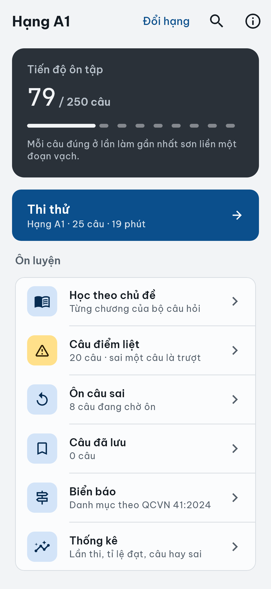
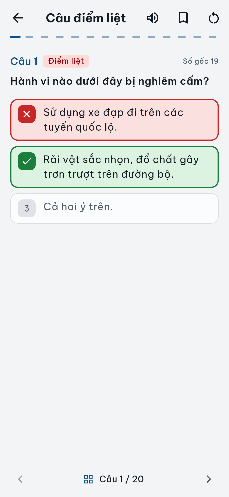
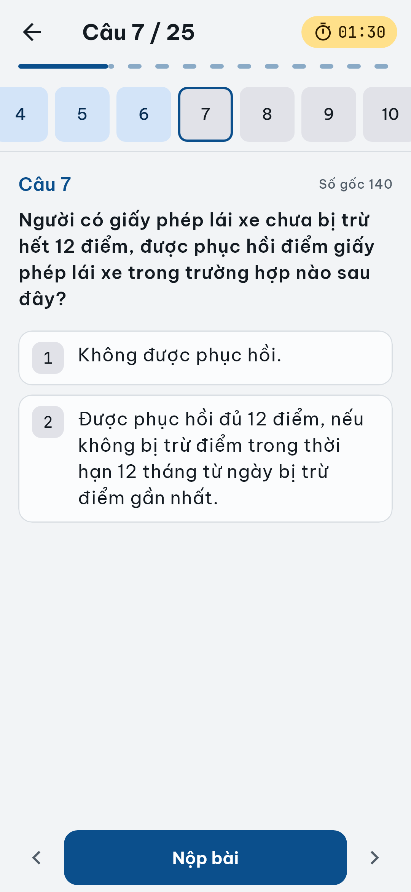
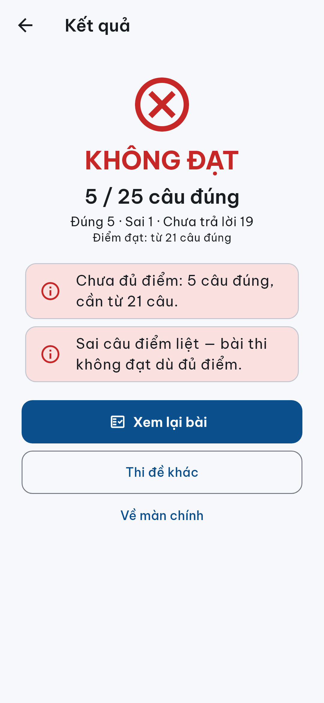
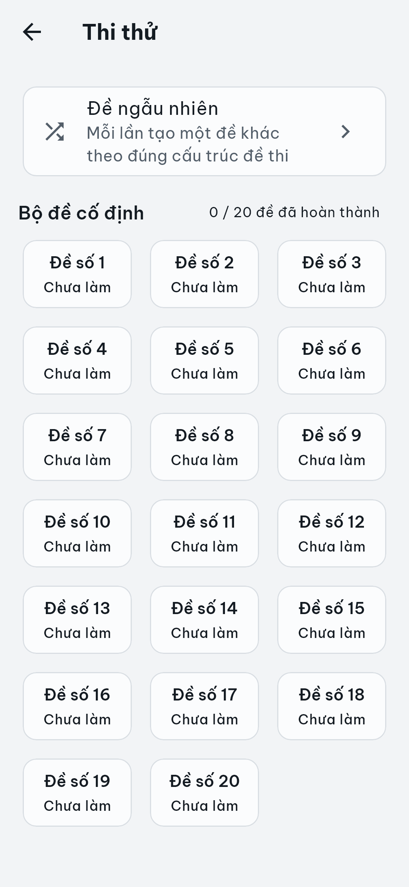
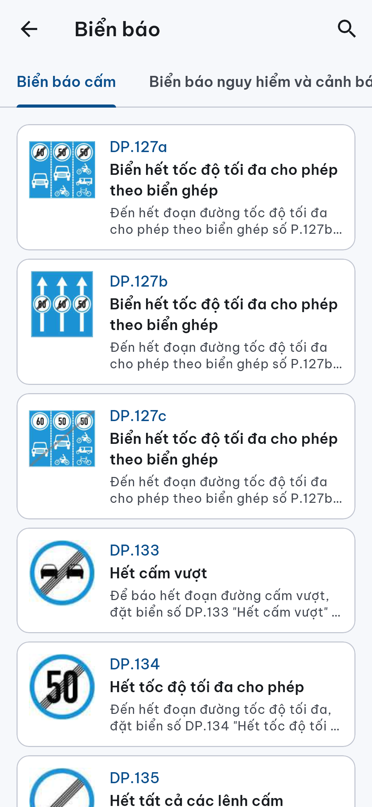
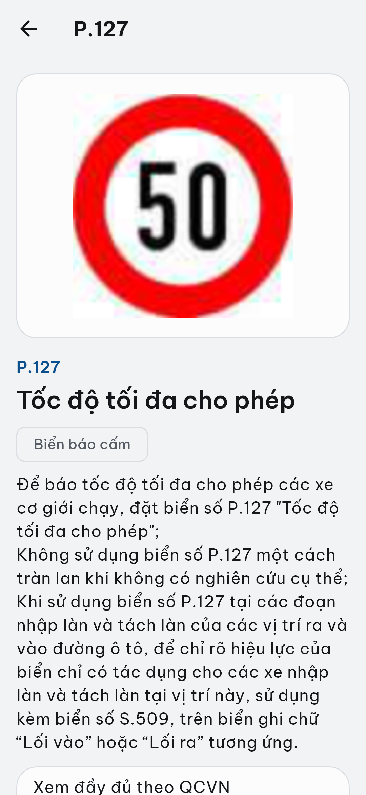
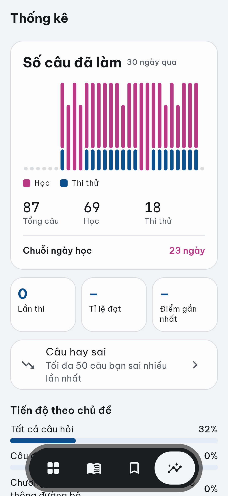

# hoclaixe — Học lái xe

Ứng dụng Flutter **ôn thi lý thuyết sát hạch giấy phép lái xe hạng A1, A, B**: chạy **offline** trên Android
(và trình duyệt), dùng nguyên văn **bộ 600 câu hỏi của Cục Cảnh sát giao thông** (áp dụng từ 01/6/2025),
cấu trúc đề theo **Công văn 2262/CSGT-P5**, danh mục biển báo theo **QCVN 41:2024/BGTVT**.

Đồ án học phần **Lập trình trên thiết bị di động** (ECMP177). Ứng dụng là sản phẩm học tập độc lập, không đại diện
cơ quan nhà nước.

<p>
  
  
  
  
</p>
<p>
  
  
  
  
</p>

## Chức năng

| Nhóm | Chức năng | Trạng thái |
|---|---|---|
| Khởi đầu | Tuyên bố miễn trừ lần đầu, chọn hạng A1 / A / B (mô tả loại xe theo Luật 36/2024/QH15 Điều 57), đổi hạng, màn Giới thiệu + nguồn dữ liệu | Hoàn thành |
| Học | Học theo chủ đề (tất cả câu, câu điểm liệt, 6 chương): đúng/sai hiện ngay, lưới số câu, nhớ câu đang dở, làm lại chủ đề; phóng to hình | Hoàn thành |
| Ôn tập | Ôn câu sai (câu ra khỏi danh sách khi đúng 2 lần liên tiếp), ôn câu điểm liệt theo hạng, 50 câu hay sai nhất | Hoàn thành |
| Thi thử | Đề ngẫu nhiên + 20 đề cố định, đồng hồ đếm ngược, đáp án lưu ngay khi chọn, hết giờ tự nộp, lưu tạm và làm tiếp, kết quả kèm lý do trượt (sai câu điểm liệt), xem lại bài | Hoàn thành |
| Biển báo | 392 biển và vạch kẻ đường chia 7 nhóm, chi tiết biển, tìm theo mã hoặc tên (không dấu) | Hoàn thành |
| Thống kê | Số lần thi, tỉ lệ đạt, điểm gần nhất, tiến độ theo chủ đề, lịch sử thi | Hoàn thành |
| Giao diện | Màu lấy từ biển báo, font Be Vietnam Pro, chế độ tối, cỡ chữ 130% không vỡ bố cục | Hoàn thành |
| Kiểm thử chấp nhận + bản APK nộp | — | Đang làm |

## Công nghệ

| Thành phần | Công nghệ / thư viện | Mục đích |
|---|---|---|
| Ứng dụng | Flutter 3.47 / Dart 3.13 | Android (chính) và web |
| Quản lý trạng thái | Riverpod 3 | Provider cho nội dung, cài đặt, tiến độ, bài thi |
| Điều hướng | go_router | Điều hướng theo trạng thái (miễn trừ → chọn hạng → màn chính) |
| Cơ sở dữ liệu | SQLite — `sqflite` (Android), `sqflite_common_ffi_web` (web) | Lưu tiến độ học, câu sai, bài thi, lịch sử — chỉ trên máy |
| Nội dung | JSON đóng gói trong `assets/` + mã băm kiểm tra | 600 câu hỏi, cấu trúc đề, danh mục biển báo (chỉ đọc) |
| Kiểm thử | flutter_test, `sqflite_common_ffi` | 129 unit + widget test (dữ liệu thật, SQLite thật trong bộ nhớ) |
| Trích xuất dữ liệu | Python 3, PyMuPDF | Trích câu hỏi, đáp án, hình, biển báo từ PDF chính thức + trang soát bằng tay |

Không có backend, không đăng nhập, không thu thập dữ liệu người dùng; tắt sao lưu Android.

## Chạy app

```powershell
git clone -c core.longpaths=true https://github.com/takidang/hoclaixe.git
cd hoclaixe
powershell -ExecutionPolicy Bypass -File tools\check-setup.ps1   # kiểm tra máy thiếu gì
cd src\app
flutter pub get
flutter run -d chrome --web-port 8080   # web: nhanh, không cần emulator
flutter run                             # Android: emulator hoặc điện thoại
```
Hoặc mở cả repo bằng VS Code: **F5** chạy app, **Ctrl+Shift+B** chạy `flutter test`.
Cài Flutter, emulator, lỗi hay gặp: [CONTRIBUTING.md](CONTRIBUTING.md) mục 2a.

Bản nộp (project Flutter ở thư mục gốc, giữ lịch sử commit): https://github.com/takidang/hoclaixe-app —
cập nhật bằng `tools\publish-app-repo.ps1`.

## Cấu trúc repo

```
src/app/                  ứng dụng Flutter (lib/core, lib/features/<tính năng>, lib/shared, test/)
data/                     dữ liệu đã trích + soát: question-bank/, sign-catalog/ (PDF gốc không commit)
tools/                    trích xuất (extract_*), kiểm tra (validate_data), đồng bộ assets, trang soát, script cho team
docs/                     srs/ (yêu cầu), architecture/ (kiến trúc + ADR), data/sources.md (nguồn), design/preview/ (ảnh),
                          reports/dev-log.md (nhật ký cho báo cáo), defense/ (ôn bảo vệ)
production/               backlog, story ST-01…ST-16, status, rủi ro
.claude/                  cấu hình Claude Code (agent, skill, rule, hook)
```

## Nguồn dữ liệu

| Dữ liệu | Văn bản |
|---|---|
| 600 câu hỏi, đáp án, hình | Bộ câu hỏi sát hạch lái xe cơ giới đường bộ — Cục CSGT, Bộ Công an (từ 01/6/2025) |
| Cấu trúc đề, câu điểm liệt theo hạng | Công văn 2262/CSGT-P5 (07/5/2025) |
| Thời gian làm bài, điểm đạt | Thông tư 12/2025/TT-BCA (đến 28/02/2027) |
| Biển báo, vạch kẻ đường | QCVN 41:2024/BGTVT |
| Loại xe theo hạng | Luật Trật tự, an toàn giao thông đường bộ 36/2024/QH15, Điều 57 |

Mọi dữ liệu trích tự động từ văn bản gốc, kiểm bằng validator và soát bằng tay; chi tiết, trang trích dẫn, mã băm file:
[docs/data/sources.md](docs/data/sources.md).

## Cách làm việc

Repo dùng **Claude Code** như một "studio" nhiều vai trò (agent) với quy trình theo phase (skill `/dev-story`,
`/story-done`, `/tam-nghi`…): mỗi chức năng là một story có acceptance criteria, có test trước khi đóng.
Nhóm duyệt mọi kế hoạch trước khi code; giảng viên cho phép dùng AI hỗ trợ viết code. Luật chung: [CLAUDE.md](CLAUDE.md).

## Hướng phát triển

Chưa làm trong học phần này, tài liệu thiết kế giữ trong `docs/` và `.claude/`:
- Trợ lý AI giải thích luật/đáp án (Gemini + RAG, bắt buộc trích dẫn văn bản–điều–khoản).
- Chụp ảnh nhận diện biển báo (AI chỉ chọn mã biển, nội dung lấy từ danh mục chuẩn).
- Cấu trúc đề mới từ 01/3/2027 (Thông tư 108/2026) khi có bộ câu hỏi chính thức.
- Hạng B1 và các hạng khác: bộ câu hỏi đã có, cần thêm cấu hình đề và bật hạng trong app.
