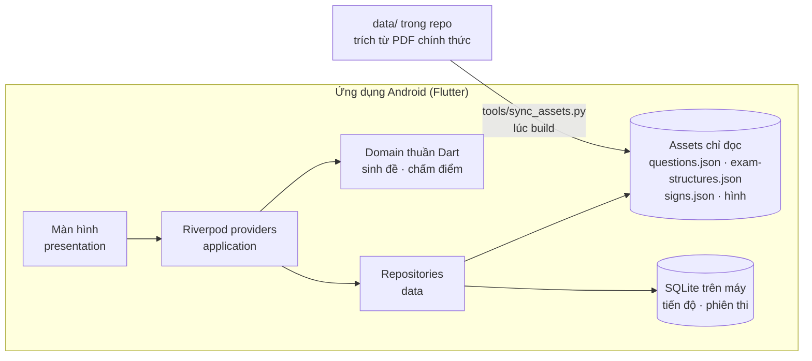
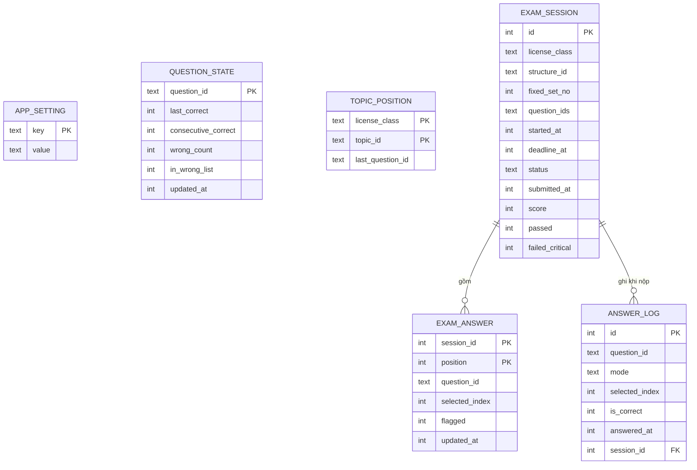
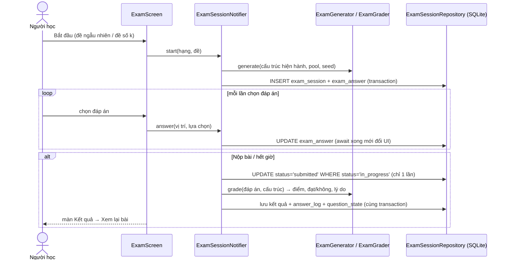
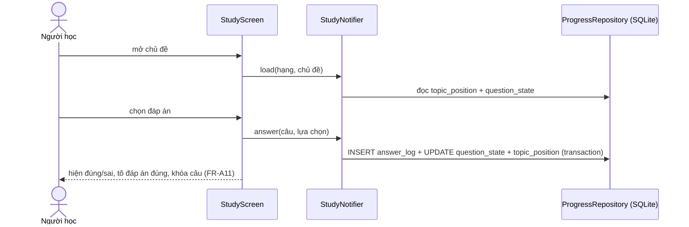

# Kiến trúc hệ thống — hoclaixe (Module A)

> Phiên bản 1.0 — 13/10/2026 · đã qua review security-reviewer; đối chiếu repo tham khảo `tdytools-gplx` (React/PWA, chỉ hạng B, không giấy phép — chỉ tham khảo ý tưởng, không dùng code/dữ liệu; repo đó chia chương lệch CV 2262) · Chủ trì: technical-director · Phạm vi: đồ án LTTTBDD (Module A, offline, không AI).
> Module B/C/D (chatbot, web, nhận diện biển) để sau — mục 11 ghi cách mở rộng mà không phải viết lại.
> Môi trường: Flutter 3.47.4 (stable), Dart 3.13.3, Android SDK 36.

## 1. Tổng quan



- **Không có backend, không cần mạng** (NFR-01, NFR-08). Nội dung (câu hỏi, cấu trúc đề, biển báo) là dữ liệu chỉ đọc
  đóng gói vào APK; chỉ dữ liệu của người học nằm trong SQLite.
- Nguồn sự thật của nội dung là `data/` (đã kiểm bằng validator); app không sửa nội dung (BR-07).

## 2. Công nghệ đã chọn

| Hạng mục | Lựa chọn | ADR |
|---|---|---|
| State management | Riverpod | ADR-001 |
| Lưu dữ liệu người học | sqflite (SQLite) | ADR-002 |
| Nội dung chỉ đọc | JSON + hình đóng gói làm assets, nạp vào bộ nhớ khi mở app | ADR-003 |
| Backend | Không có cho Module A | ADR-004 |
| Điều hướng | go_router | ADR-005 |

Phiên bản package cụ thể chốt trong `/setup-flutter` (kiểm tra bản mới nhất tương thích Flutter 3.47).

## 3. Kiến trúc ứng dụng

### 3.1 Phân lớp
| Lớp | Nội dung | Được phép phụ thuộc |
|---|---|---|
| presentation | Widget, màn hình, đọc/ghi state qua `ref` | application, domain |
| application | Provider/Notifier: `licenseClassProvider`, `topicProgressProvider`, `examSessionNotifier`, `wrongListProvider`… | domain, data (qua interface) |
| domain | Model bất biến (`Question`, `Sign`, `ExamStructure`, `ExamSession`, `ExamResult`), dịch vụ thuần: `ExamGenerator`, `ExamGrader`, `StructurePicker` | không gì (Dart thuần, không Flutter, không `dart:io`) |
| data | `ContentRepository` (assets), `ProgressRepository`, `ExamSessionRepository` (sqflite), `AppDatabase` (mở DB, migration) | domain |

### 3.2 Cấu trúc thư mục (`src/app/`)
```
lib/
  main.dart                 # ProviderScope, khởi tạo DB + nạp nội dung, MaterialApp.router
  core/
    db/app_database.dart    # mở SQLite, WAL, migration theo version
    router.dart             # go_router: các route
    theme/                  # design system (màu, chữ, khoảng cách) — lấy từ Claude Design
    strings.dart            # mọi chuỗi hiển thị (NFR-09)
  features/
    onboarding/             # miễn trừ lần đầu + chọn hạng (UC-01, UC-02)
    home/                   # màn chính
    study/                  # học theo chủ đề, ôn câu sai, câu điểm liệt (UC-03, 06, 07) — dùng chung QuestionView
    exam/                   # thi thử, bộ đề cố định, kết quả, xem lại (UC-04, 05)
    signs/                  # danh mục biển báo (UC-08)
    about/                  # giới thiệu, nguồn dữ liệu (FR-A02)
    stats/                  # thống kê, câu hay sai (Should — làm nếu kịp)
  shared/widgets/           # QuestionView, AnswerOption, ImageZoom, QuestionGrid…
assets/
  data/questions.json  data/exam-structures.json  data/signs.json
  images/questions/…   images/signs/…
test/                       # unit (domain), widget, integration
```
Mỗi feature theo `presentation / application / domain / data` khi cần (quy tắc `.claude/rules/flutter-code.md`).

### 3.3 Nạp nội dung
`tools/sync_assets.py` sao chép `data/question-bank/{questions,exam-structures}.json`, `data/sign-catalog/signs.json`
và thư mục hình sang `src/app/assets/` (đổi đường dẫn hình cho khớp) và ghi `assets/data/content_version.json`
(phiên bản dữ liệu + SHA-256 từng file). Chạy trước mỗi lần build; validator phải PASS **trên chính `src/app/assets/`**.
Một unit test so hash trong `content_version.json` với file thật → lệch thì test fail (quên sync / sync sai).
Mở app: kiểm tra JSON đúng cấu trúc; hỏng → màn lỗi rõ ràng, không crash. Seed bộ đề cố định gắn với phiên bản dữ liệu.
(APK có thể bị đóng gói lại để sửa assets — với app ôn thi offline của đồ án, rủi ro này được chấp nhận.)
Lúc mở app: `ContentRepository` đọc 3 file JSON một lần (`rootBundle`), parse trong isolate (`compute`) → giữ trong
bộ nhớ (~1.000 mục, < 2 MB) → mọi màn truy vấn tức thì, không cần DB cho nội dung.

## 4. Thiết kế dữ liệu (SQLite)



| Bảng | Mục đích | Yêu cầu |
|---|---|---|
| `app_setting` | đã đồng ý miễn trừ, hạng đang chọn, giao diện | FR-A01, A04, A61 |
| `question_state` | kết quả mới nhất, số lần đúng liên tiếp, tổng số lần sai, đang trong "Câu sai" — đếm Đúng/Sai/Chưa làm theo chủ đề nhanh. Sai → vào "Câu sai", `consecutive_correct = 0`; đúng **2 lần liên tiếp** → ra khỏi "Câu sai" (GA4) | FR-A10, A40, A41, A51 |
| `answer_log` | nhật ký mọi lần trả lời (học, ôn, thi) — nguồn cho thống kê; `question_state` cập nhật trong cùng transaction | FR-A50 |
| `topic_position` | câu đang dở của từng chủ đề | FR-A13 |
| `exam_session` | ảnh chụp đề (danh sách id câu theo thứ tự, id cấu trúc đề), hạn giờ, trạng thái, kết quả | BR-09, FR-A25–A29 |
| `exam_answer` | đáp án từng vị trí, cập nhật **ngay khi chọn** | FR-A24, NFR-02 |

- Khóa câu hỏi là `id` ổn định (`Q0001…Q0600`), **không bao giờ tái sử dụng id** → cập nhật bộ dữ liệu không mất tiến
  độ (FR-A70). Phiên thi cũ trỏ tới id không còn tồn tại → màn xem lại hiện "Câu này không còn trong bộ đề hiện hành"
  (có test).
- Mở DB: `PRAGMA foreign_keys=ON` (sqflite mặc định tắt), `journal_mode=WAL`.
- Migration theo `PRAGMA user_version`: mỗi bước `onUpgrade` tăng dần, chạy trong transaction; `onDowngrade` → từ chối
  (báo lỗi), không xóa dữ liệu; có test mở DB phiên bản cũ.
- DDL phiên bản 1 có sẵn: `CREATE UNIQUE INDEX one_open_session ON exam_session(status) WHERE status='in_progress'`
  (tối đa 1 phiên dở — BR-09) và `UNIQUE(session_id, question_id)` cho `answer_log` của phiên thi (chống ghi đôi khi nộp).

## 5. Luồng chính

### 5.1 Thi thử (UC-04, UC-05)

- **Đồng hồ** (FR-A21, BR-06, GA7): `deadline_at = started_at + thời gian đề` (giờ thực). Khi app chạy, hiển thị theo
  `Stopwatch` đơn điệu; khi app mở lại tính từ `deadline_at` → hết giờ thì tự nộp (FR-A25, UC-04 E2).
- **Sinh đề** (BR-02, BR-03): chọn 1 câu điểm liệt trong `criticalFor` của hạng; mỗi nhóm chương lấy đủ số câu trong
  pool trừ câu điểm liệt của hạng; không trùng; sắp theo thứ tự nhóm, xáo trong nhóm (GA6); không xáo đáp án.
  Đề ngẫu nhiên: seed ngẫu nhiên. **Bộ đề cố định** (FR-A20b): seed = hàm của (hạng, số đề, phiên bản dữ liệu) → 20 đề
  giống nhau mỗi lần mở app.
- **Không gợi ý điểm liệt khi đang thi** (giống phần mềm sát hạch): màn thi không hiện nhãn "Điểm liệt"; màn thông tin đề chỉ nói "có 1 câu điểm liệt"; nhãn chỉ hiện ở Kết quả / Xem lại bài. Chế độ học và ôn vẫn hiện nhãn (FR-A11).
- **Chấm** (BR-04, BR-05): điểm = số câu đúng; chưa trả lời = sai; đạt khi điểm ≥ điểm đạt **và** đúng câu điểm liệt.
- **Nộp đúng một lần** (FR-A26, UC-04 E3): đổi status + chấm + ghi `answer_log`/`question_state` nằm trong **một**
  `db.transaction`; câu `UPDATE … WHERE status='in_progress'` trả `rowsAffected == 0` → phiên đã nộp, bỏ qua, không chấm
  lại. App bị tắt giữa chừng → transaction không hoàn tất → lần mở sau nộp lại đúng một lần.
- **Lỗi ghi DB** (UC-04 E1): nộp tay bị chặn tới khi lưu được; hết giờ vẫn chấm theo đáp án đang hiển thị + cảnh báo.

### 5.2 Học theo chủ đề (UC-03, 06, 07)


## 6. Kiểm thử (gắn với SRS)
| Lớp | Nội dung | Yêu cầu |
|---|---|---|
| Unit (domain) | 1.000 đề/hạng đúng BR-02, BR-03; bảng ca chấm điểm (sai/bỏ trống điểm liệt, đúng ngưỡng 21/23/27…) | NFR-05, NFR-05b |
| Golden fixtures | Ảnh chụp đầy đủ dữ liệu 6 câu tiêu biểu (1, 19, 206, 301, 486, 600) và vài biển (P.101, W.201a, R.301a) trong `test/fixtures/`; dữ liệu đổi khác → test fail, phải xác nhận lại với PDF | NFR-04 |
| Unit (data) | sqflite_common_ffi chạy trên máy dev: lưu/đọc đáp án, nộp 1 lần, phiên dở | FR-A24–A26 |
| Widget | QuestionView, lưới câu, màn kết quả | FR-A11, A22, A27 |
| Thủ công trên máy thật | 6 kịch bản giữ đáp án (kể cả force-stop), offline (chế độ máy bay) | NFR-01, NFR-02 |

## 7. Offline và dữ liệu
100% offline. Không có đồng bộ. **Tắt sao lưu Android** (`android:allowBackup="false"` + `dataExtractionRules` loại trừ
toàn bộ cho Android 12+): tiến độ không lên Google Drive và không bị khôi phục lệch phiên bản sang máy khác. Gỡ app = mất
tiến độ — chấp nhận cho đồ án, màn Giới thiệu ghi "Tiến độ chỉ lưu trên máy này". Đăng nhập/đồng bộ là Could, để sau.

## 8. Bảo mật và riêng tư
- Không thu thập dữ liệu cá nhân: `answer_log`, `exam_session` là dữ liệu học tập, không phải PII; không ID thiết bị,
  không analytics, không gửi crash report ra ngoài, không tài khoản.
- **Quyền**: manifest `main` không có quyền nào; INTERNET chỉ có ở manifest `debug`/`profile` (Flutter cần cho hot reload).
  Kiểm khi phát hành: `aapt dump permissions app-release.apk` phải rỗng (kể cả quyền plugin kéo vào qua merged manifest)
  — thêm vào `/release-checklist`. Chọn plugin ít phụ thuộc (mở link nguồn bằng `url_launcher` không cần INTERNET; vẫn kiểm).
- Không có khóa/bí mật trong code (không có backend). Keystore ký APK nằm ngoài git (`*.jks`, `*.keystore`,
  `key.properties` đã trong `.gitignore`; bổ sung `local.properties` ở `/setup-flutter`), có bản sao lưu ngoài repo.
  Trước release chạy `git log --all -- '*.jks' key.properties` để chắc chưa từng commit.
- Log: không `print`/`debugPrint` dữ liệu người học ở bản release (dùng `kReleaseMode`).
- Dữ liệu SQLite nằm trong vùng riêng của app; release build dùng `--obfuscate --split-debug-info`.

## 9. Hiệu năng
Nạp nội dung trong isolate lúc khởi động (NFR-03 ≤ 3 s); hình câu hỏi/biển là ảnh nhỏ (≤ 100 KB), dùng `Image.asset` có
`cacheWidth`; danh sách dài dùng `ListView.builder`. APK dự kiến < 30 MB (NFR-06 ≤ 50 MB).

## 10. Rủi ro kỹ thuật
| Rủi ro | Ứng phó |
|---|---|
| Mất đáp án khi app bị tắt | Ghi DB trước khi đổi UI; WAL; test force-stop (NFR-02) |
| Đồng hồ sai khi app ở nền | Dựa `deadline_at` giờ thực, không dựa timer chạy nền |
| Dữ liệu assets lệch `data/` | `tools/sync_assets.py` + validator trên `src/app/assets` + test hash `content_version.json` |
| Plugin kéo thêm quyền INTERNET vào bản release | Kiểm `aapt dump permissions` trong `/release-checklist` |
| Trễ hạn 28/10 | Thứ tự cắt trong `production/roadmap.md` |

## 11. Mở rộng sau 28/10 (không làm bây giờ)
- **Web (Module C)**: `domain` là Dart thuần nên dùng lại nguyên; `data` đặt sau interface → thay sqflite bằng bản web
  (`sqflite_common_ffi_web`) hoặc drift. Không cần sửa presentation.
- **Chatbot / nhận diện biển (B, D)**: thêm feature mới gọi backend proxy (API key chỉ ở backend — CLAUDE.md);
  khi đó bổ sung quyền INTERNET và ADR backend riêng.
