**BỘ GIÁO DỤC VÀ ĐÀO TẠO**

**TRƯỜNG ĐẠI HỌC CÔNG NGHỆ TP. HỒ CHÍ MINH**

**BÁO CÁO ĐỒ ÁN CUỐI KỲ**

**HỌC PHẦN: LẬP TRÌNH TRÊN THIẾT BỊ DI ĐỘNG (ECMP177)**

**XÂY DỰNG ỨNG DỤNG DI ĐỘNG ÔN THI LÝ THUYẾT**

**SÁT HẠCH GIẤY PHÉP LÁI XE HẠNG A1, A, B**

*(Ứng dụng “Học lái xe”)*

Ngành: **Công Nghệ Thông Tin**

Học kỳ – Năm học: **1A - 2026**

Giảng viên phụ trách: **Trần Đăng Khoa**

Nhóm sinh viên thực hiện: **Nhóm 8**

| **STT** | **Họ và tên**                 | **MSSV**   | **Lớp** |
|---------|-------------------------------|------------|---------|
| 1       | Đặng Lê Tấn Tài (trưởng nhóm) | 2380601937 | 23DTHD1 |
| 2       | Nguyễn Đỗ Tuấn Kiệt           | 2380601147 | 23DTHD1 |
| 3       | Lê Tiến Đạt                   | 2380614578 | 23DTHD1 |
| 4       | Nguyễn Phan Gia An            | 2380600012 | 23DTHD1 |
| 5       | Lê Việt Đức                   | 2380600534 | 23DTHD1 |

*Thành phố Hồ Chí Minh, ngày 31 tháng 10 năm 2026*

**MỤC LỤC**

**DANH MỤC HÌNH ẢNH**

**DANH MỤC BẢNG**

**CÁC TỪ VIẾT TẮT VÀ THUẬT NGỮ**

| **Từ / thuật ngữ**           | **Ý nghĩa**                                                                |
|------------------------------|----------------------------------------------------------------------------|
| GPLX                         | Giấy phép lái xe                                                           |
| CSGT                         | Cảnh sát giao thông                                                        |
| QCVN 41:2024                 | Quy chuẩn kỹ thuật quốc gia về báo hiệu đường bộ (biển báo, vạch kẻ đường) |
| Câu điểm liệt                | Câu hỏi bắt buộc phải trả lời đúng; sai câu này là trượt dù đủ điểm        |
| SQLite                       | Cơ sở dữ liệu dạng file nằm ngay trên điện thoại, không cần máy chủ        |
| Giao dịch CSDL (transaction) | Nhóm lệnh ghi CSDL chạy “tất cả hoặc không gì cả”, không bị ghi dở dang    |
| Riverpod                     | Thư viện quản lý trạng thái (state management) cho Flutter                 |
| TTS                          | Text-to-Speech: bộ đọc văn bản thành giọng nói có sẵn trên điện thoại      |
| Use case (UC)                | Một chức năng mà người dùng thực hiện với hệ thống                         |
| Widget test / Unit test      | Kiểm thử tự động giao diện / kiểm thử tự động từng hàm nghiệp vụ           |

# CHƯƠNG 1: GIỚI THIỆU ĐỀ TÀI

## 1.1. Lý do chọn đề tài

Từ ngày 01/6/2025, phần thi lý thuyết sát hạch giấy phép lái xe sử dụng bộ 600 câu hỏi mới của Cục Cảnh sát giao thông (bắt buộc trên toàn quốc từ 01/9/2025). Cùng thời gian đó, Luật Trật tự, an toàn giao thông đường bộ số 36/2024/QH15 và QCVN 41:2024/BGTVT về báo hiệu đường bộ có hiệu lực từ 01/01/2025. Tài liệu và ứng dụng ôn thi cũ vì vậy dễ lỗi thời, người học khó biết nguồn nào đúng.

Các ứng dụng ôn thi phổ biến trên Google Play có nhiều quảng cáo, và có phản hồi của người dùng rằng đáp án đã chọn bị thay đổi khi nộp bài. Nhóm chọn đề tài này để xây dựng một ứng dụng ôn thi **không quảng cáo, chạy offline, dữ liệu lấy nguyên văn từ văn bản chính thức và lưu đáp án tin cậy**.

## 1.2. Mục tiêu và phạm vi

- Hỗ trợ ôn thi lý thuyết cho ba hạng **A1, A và B**, đúng số câu, thời gian, điểm đạt và quy tắc câu điểm liệt theo quy định hiện hành.

- Đầy đủ các chức năng chính: học theo chủ đề, ôn câu sai, ôn câu điểm liệt, thi thử bấm giờ, tra cứu biển báo, thống kê tiến độ; thêm câu đã lưu, tìm câu hỏi và đọc câu hỏi.

- Chạy hoàn toàn **offline**, không cần tài khoản, không thu thập dữ liệu người dùng; nền tảng chính là **Android**, cùng mã nguồn chạy được trên trình duyệt (Flutter Web).

- **Ngoài phạm vi:** mẹo ghi nhớ, lời giải từng câu (bộ đề chính thức không có lời giải), thi mô phỏng tình huống, đăng nhập và các chức năng AI.

## 1.3. Tóm tắt kết quả

| **Hạng mục** | **Kết quả**                                                                                        |
|--------------|----------------------------------------------------------------------------------------------------|
| Sản phẩm     | Ứng dụng Android “Học lái xe” viết bằng Flutter/Dart, chạy offline                                 |
| Dữ liệu      | 600 câu hỏi, 293 hình, cấu trúc đề A1/A/B, 392 biển báo và vạch kẻ đường; soát khớp 600/600 đáp án |
| Chức năng    | 41 chức năng hoàn thành, 1 chức năng chưa ổn định, 1 việc chưa hoàn thiện (Bảng chức năng mục 3.5) |
| Kiểm thử     | 178 test tự động đạt (lần chạy 30/10/2026), phiếu kiểm thử 32 mục, chạy thử trên máy ảo Android    |
| Mã nguồn     | https://github.com/takidang/hoclaixe (công khai), thư mục ứng dụng: src/app                        |

# CHƯƠNG 2: PHÂN TÍCH VÀ THIẾT KẾ UML

Chương này mô tả ứng dụng bằng bốn loại sơ đồ UML: **use case** (ai dùng, dùng chức năng gì), **hoạt động** (luồng xử lý từng bước), **tuần tự** (các lớp trong code gọi nhau theo thứ tự nào) và **lớp** (code gồm những lớp nào, liên hệ ra sao). Toàn bộ nội dung sơ đồ được viết bằng tiếng Việt. Để giảng viên tra lại được trong mã nguồn, bên dưới các sơ đồ lớp và sơ đồ CSDL có **bảng đối chiếu** giữa tên tiếng Việt trong sơ đồ và tên lớp, tên bảng thật trong code. Cuối chương là kiến trúc ứng dụng và nơi lưu dữ liệu.

## 2.1. Biểu đồ use case

### 2.1.1. Biểu đồ use case tổng quát

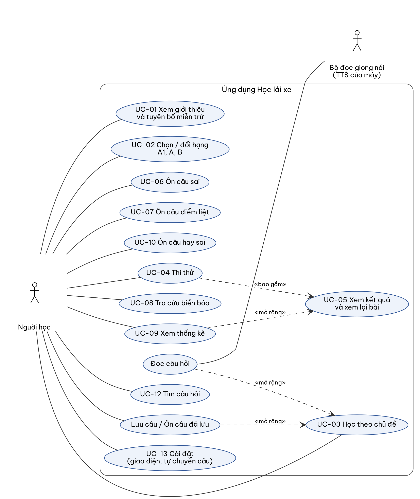

*Hình 1: Biểu đồ use case tổng quát*

Ứng dụng có một tác nhân chính là **Người học**; không có quản trị viên vì ứng dụng không có máy chủ (backend) và không có tài khoản. Tác nhân phụ là **bộ đọc giọng nói (TTS) của máy**, được dùng khi người học bật Đọc câu hỏi. Mã use case (UC-01 … UC-13) giữ theo tài liệu đặc tả yêu cầu (SRS) của dự án; UC-11 (chọn cấu trúc đề năm 2027) chưa làm nên không có trong biểu đồ.

- **UC-04 Thi thử** bao gồm **UC-05 Xem kết quả và xem lại bài**: bài thi nào nộp xong cũng hiện kết quả.

- **UC-09 Xem thống kê** mở rộng UC-05: chạm một bài trong lịch sử thi để xem lại bài đó.

- **Đọc câu hỏi** và **Lưu câu** mở rộng UC-03 Học theo chủ đề: là các nút trên màn làm câu hỏi, người học dùng khi cần.

Do biểu đồ tổng quát chỉ thể hiện được tên chức năng lớn, các mục 2.1.2 – 2.1.5 phân rã thành **4 biểu đồ use case chi tiết** theo bốn nhóm chức năng.

### 2.1.2. Use case phân rã: Khởi đầu và cài đặt

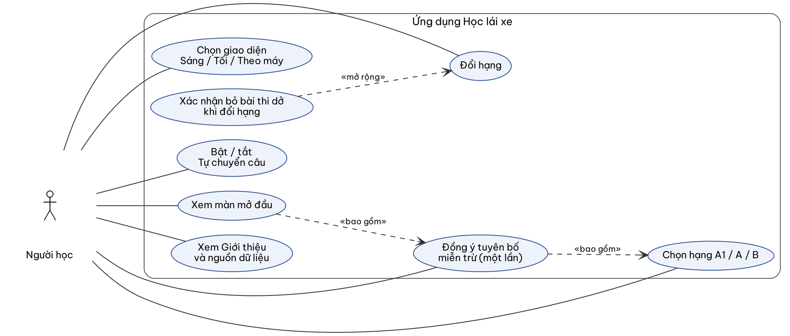

*Hình 2: Use case phân rã – Khởi đầu và cài đặt (UC-01, UC-02, UC-13)*

Lần đầu mở ứng dụng, người học xem màn mở đầu, đồng ý tuyên bố miễn trừ (chỉ một lần) rồi chọn hạng – ba bước này nối nhau bằng quan hệ «bao gồm» (bắt buộc xảy ra). Đổi hạng có thể dẫn tới bước **xác nhận bỏ bài thi dở** (quan hệ «mở rộng»: chỉ xảy ra khi có điều kiện) khi đang có bài thi chưa nộp của hạng khác. Màn Giới thiệu cho chọn giao diện và bật/tắt Tự chuyển câu.

### 2.1.3. Use case phân rã: Học và ôn tập

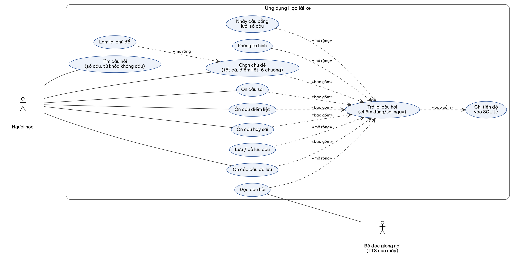

*Hình 3: Use case phân rã – Học và ôn tập (UC-03, UC-06, UC-07, UC-10, UC-12)*

Năm cách học (chọn chủ đề, ôn câu sai, ôn câu điểm liệt, ôn câu hay sai, ôn câu đã lưu) đều dẫn tới cùng một use case **Trả lời câu hỏi**: ứng dụng chấm đúng/sai ngay và luôn **ghi tiến độ vào SQLite**. Nhảy câu, phóng to hình, lưu câu và đọc câu hỏi là các thao tác mở rộng trên màn trả lời câu hỏi.

### 2.1.4. Use case phân rã: Thi thử

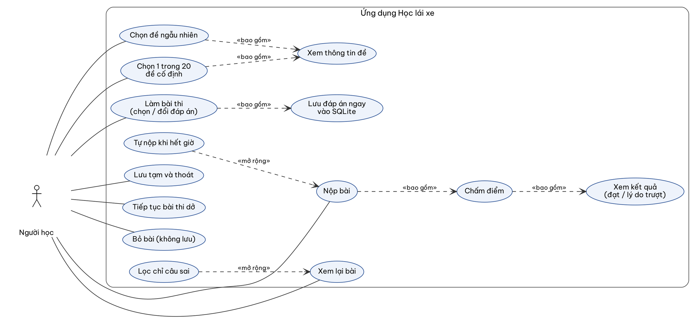

*Hình 4: Use case phân rã – Thi thử (UC-04, UC-05)*

Người học chọn đề ngẫu nhiên hoặc một trong 20 đề cố định, xem thông tin đề rồi làm bài. Mỗi lần chọn đáp án đều «bao gồm» **lưu đáp án ngay vào SQLite**. Bài thi có ba cách kết thúc: nộp bài (bao gồm chấm điểm và xem kết quả), lưu tạm để làm tiếp sau, hoặc bỏ bài. **Tự nộp khi hết giờ** là trường hợp mở rộng của nộp bài.

### 2.1.5. Use case phân rã: Biển báo và thống kê

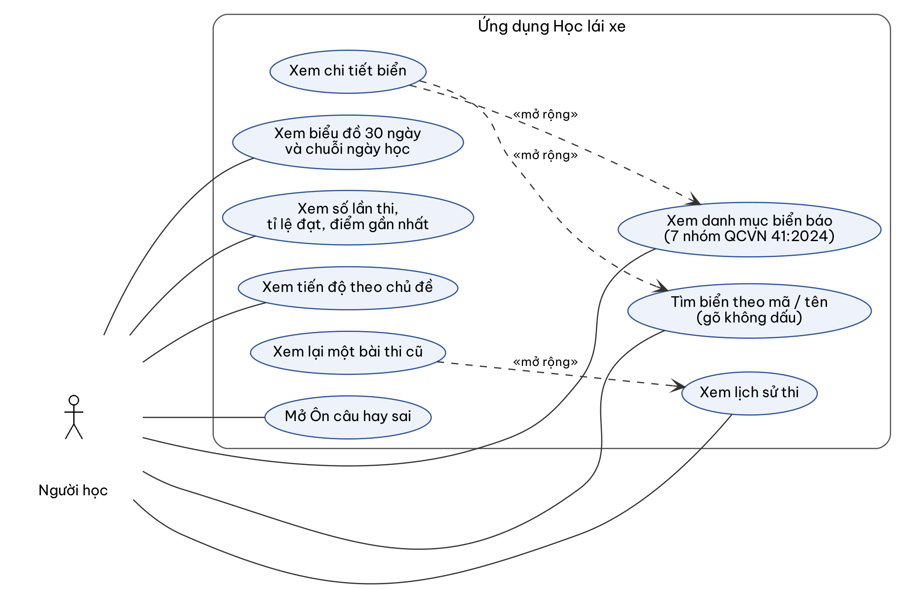

*Hình 5: Use case phân rã – Biển báo và thống kê (UC-08, UC-09, UC-10)*

Người học xem danh mục 392 biển báo và vạch kẻ đường hoặc tìm theo mã/tên; từ cả hai nơi đều mở được chi tiết biển. Màn Thống kê cho xem biểu đồ 30 ngày, số lần thi, tỉ lệ đạt, tiến độ theo chủ đề, lịch sử thi (mở rộng: xem lại một bài thi cũ) và mở Ôn câu hay sai.

## 2.2. Biểu đồ hoạt động

### 2.2.1. Biểu đồ hoạt động: Thi thử

Thi thử là luồng phức tạp nhất của ứng dụng. Nếu đang có bài thi dở, người học có thể tiếp tục bài đó với đáp án đã lưu và hạn giờ cũ (nếu đã quá giờ thì bài được tự nộp). Mỗi lần chọn đáp án, ứng dụng ghi vào SQLite trước rồi mới hiện lên màn hình. Bài thi kết thúc theo ba cách: hết giờ thì tự nộp; bấm Nộp bài; hoặc thoát qua bảng “Kết thúc bài thi?” (lưu tạm hoặc bỏ bài). Khi chấm, bài chỉ ĐẠT nếu **đủ điểm và đúng câu điểm liệt**.

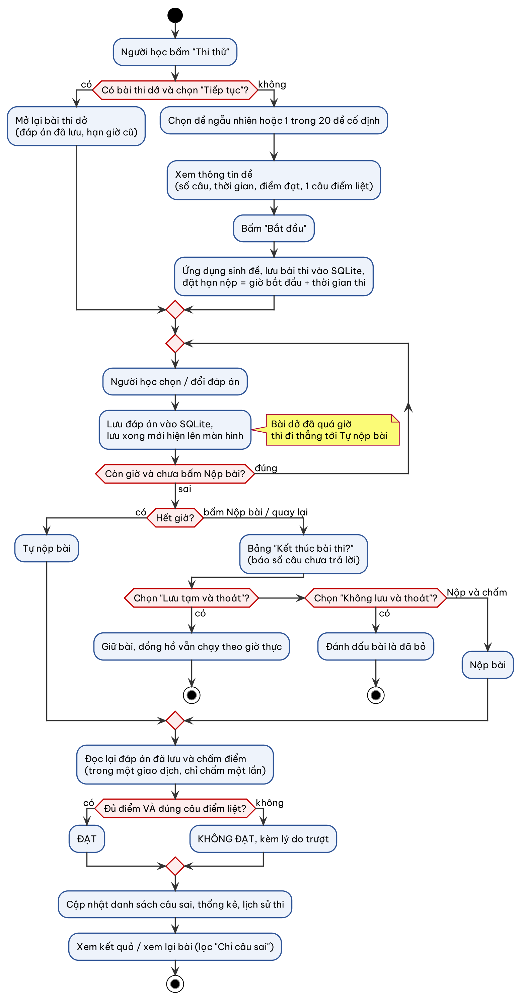

*Hình 6: Biểu đồ hoạt động của chức năng Thi thử*

### 2.2.2. Biểu đồ hoạt động: Học theo chủ đề và ôn câu sai

Học theo chủ đề và các chế độ ôn (câu sai, câu điểm liệt, câu hay sai, câu đã lưu) dùng chung một luồng. Khác với thi thử, câu được chấm ngay khi chọn và bị khóa. Câu trả lời sai vào danh sách Câu sai; câu chỉ ra khỏi danh sách khi trả lời **đúng 2 lần liên tiếp**.

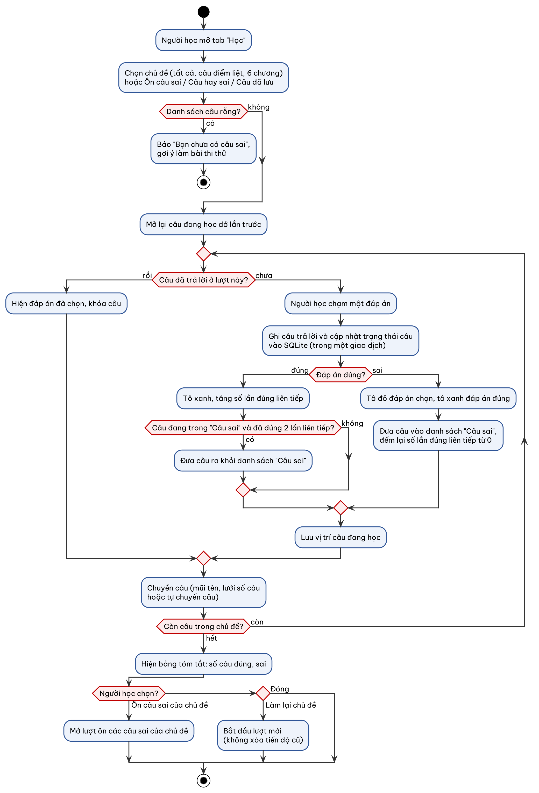

*Hình 7: Biểu đồ hoạt động của chức năng Học theo chủ đề và ôn tập*

## 2.3. Biểu đồ tuần tự

Biểu đồ tuần tự cho thấy các lớp trong mã nguồn gọi nhau theo thứ tự thời gian. Nhóm vẽ ba biểu đồ cho ba tình huống quan trọng: mở ứng dụng, trả lời câu hỏi khi học, và làm bài – nộp bài thi.

### 2.3.1. Biểu đồ tuần tự: Mở ứng dụng

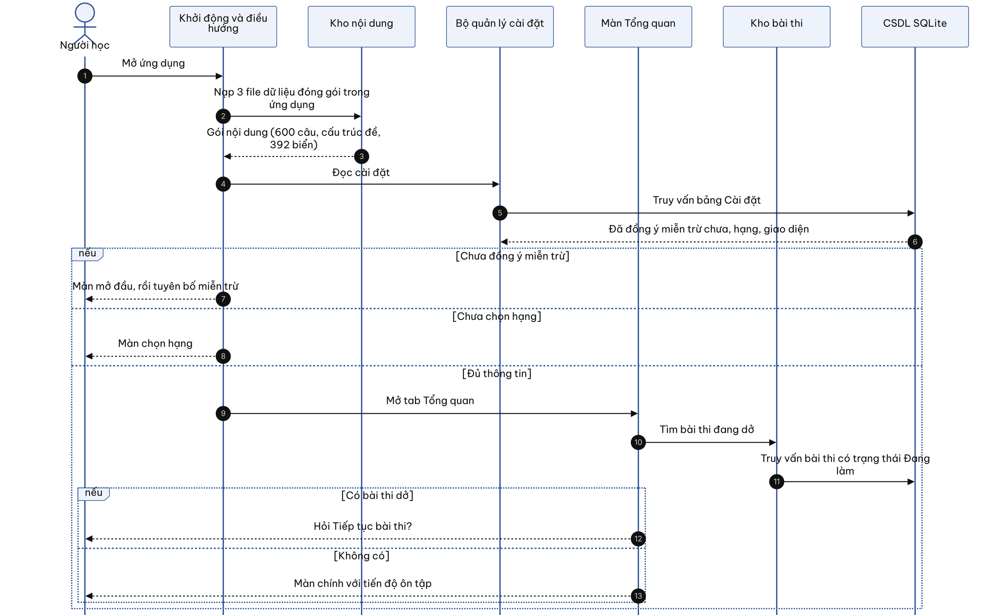

*Hình 8: Biểu đồ tuần tự khi mở ứng dụng*

Khi mở ứng dụng, **Kho nội dung** đọc ba file dữ liệu đóng gói trong ứng dụng một lần và giữ trong bộ nhớ (bước 2–3). Phần điều hướng đọc bảng Cài đặt trong CSDL (bước 4–6) để quyết định mở màn nào: chưa đồng ý miễn trừ → màn mở đầu; chưa chọn hạng → màn chọn hạng; đủ thông tin → tab Tổng quan. Màn Tổng quan hỏi **Kho bài thi** xem có bài thi dở không (bước 10–11) để hiện câu hỏi “Tiếp tục bài thi?”.

### 2.3.2. Biểu đồ tuần tự: Trả lời câu hỏi khi học

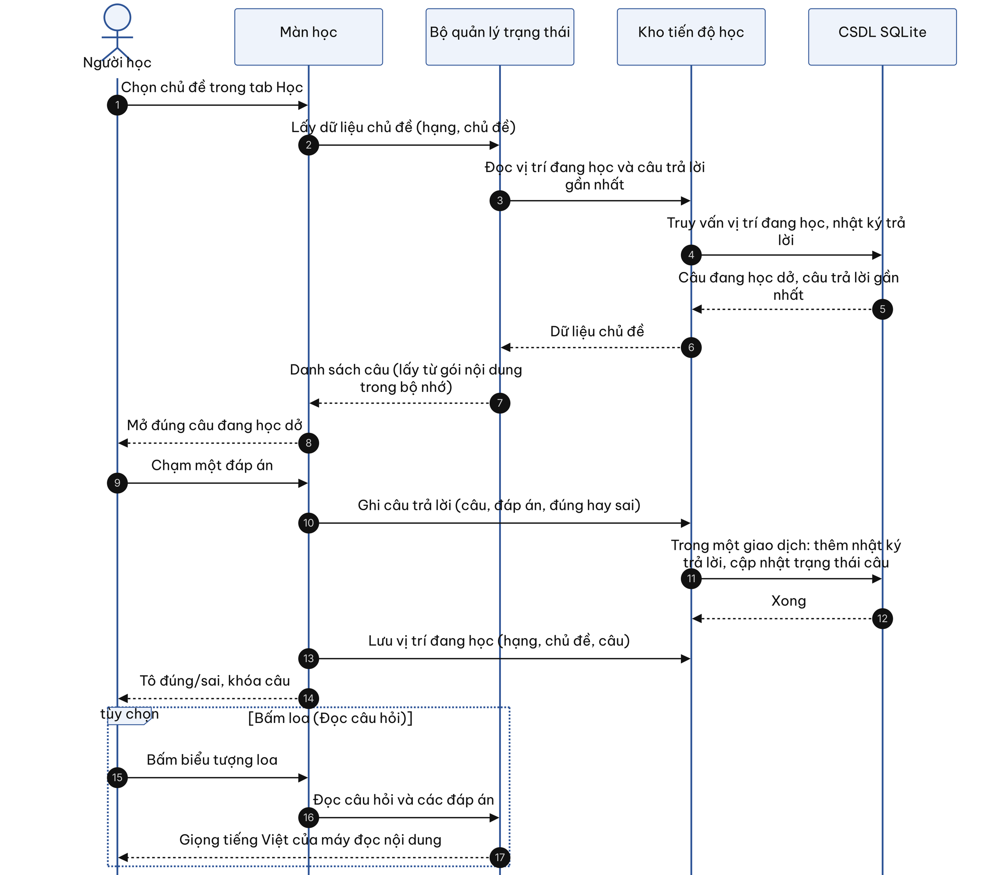

*Hình 9: Biểu đồ tuần tự khi học theo chủ đề*

Mở chủ đề, ứng dụng đọc vị trí đang học dở và câu trả lời gần nhất từ SQLite (bước 2–7). Khi người học chạm đáp án, **Kho tiến độ học** ghi nhật ký trả lời và cập nhật trạng thái câu trong **một giao dịch CSDL** (bước 10–12) – nghĩa là hai việc này hoặc cùng xong, hoặc cùng không xảy ra, sau đó lưu vị trí đang học và tô đúng/sai trên màn hình. Nút loa gọi bộ đọc giọng nói tiếng Việt của máy (bước 15–17).

### 2.3.3. Biểu đồ tuần tự: Làm bài và nộp bài thi

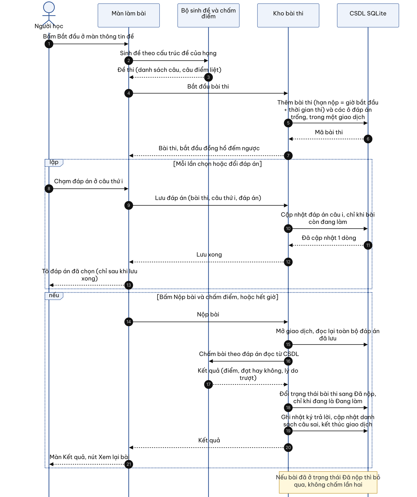

*Hình 10: Biểu đồ tuần tự khi làm bài và nộp bài thi*

Biểu đồ thể hiện hai cơ chế giúp đáp án **không bao giờ mất hay bị đổi**:

- **Bước 8–13 (lưu đáp án):** Màn làm bài gửi lệnh lưu kèm chính vị trí câu vừa chạm; chỉ khi CSDL báo đã cập nhật đúng 1 dòng thì giao diện mới tô đáp án. Vì vậy màn hình không bao giờ hiện một đáp án chưa được lưu, và tắt ứng dụng giữa chừng cũng không mất đáp án.

- **Bước 14–21 (nộp bài):** toàn bộ việc nộp nằm trong một giao dịch CSDL; ứng dụng chấm theo đáp án **đọc lại từ cơ sở dữ liệu**, không theo dữ liệu trên màn hình. Lệnh đổi trạng thái chỉ có hiệu lực khi bài còn ở trạng thái “Đang làm”, nên bấm nộp nhiều lần hoặc hết giờ đúng lúc bấm nộp cũng chỉ chấm một lần.

## 2.4. Biểu đồ lớp

Mã nguồn chia theo chức năng, mỗi chức năng gồm ba tầng: giao diện, nghiệp vụ (viết bằng Dart thuần) và dữ liệu. Biểu đồ lớp dưới đây chỉ gồm các lớp nghiệp vụ và dữ liệu chính, chia làm hai nhóm. Các lớp giao diện (màn hình, widget) không đưa vào để biểu đồ dễ đọc. Mỗi lớp ghi tên, các thuộc tính chính (ngăn giữa) và các thao tác chính (ngăn dưới); kiểu dữ liệu và tham số được lược bớt cho gọn.

### 2.4.1. Nhóm lớp nội dung

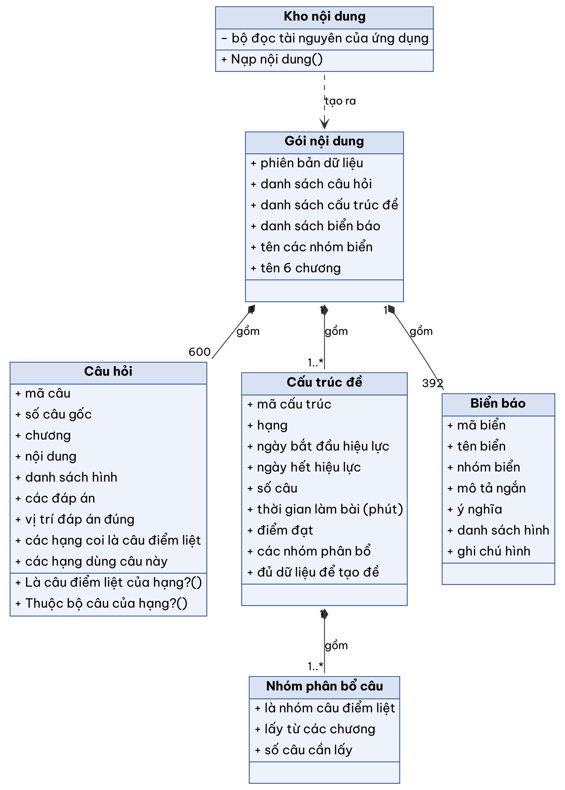

*Hình 11: Biểu đồ lớp nhóm nội dung (câu hỏi, cấu trúc đề, biển báo)*

**Bảng 1: Đối chiếu và giải thích các lớp nhóm nội dung**

| **Tên trong sơ đồ** | **Tên lớp trong code** | **Vai trò**                                                                                         |
|---------------------|------------------------|-----------------------------------------------------------------------------------------------------|
| Kho nội dung        | ContentRepository      | Đọc 3 file dữ liệu đóng gói trong ứng dụng khi khởi động, xử lý ở luồng phụ để không đứng giao diện |
| Gói nội dung        | ContentBundle          | Toàn bộ nội dung chỉ đọc giữ trong bộ nhớ: 600 câu, các cấu trúc đề, 392 biển, tên 6 chương         |
| Câu hỏi             | Question               | Một câu trong bộ 600 câu: mã câu, số câu gốc, các đáp án, đáp án đúng, câu điểm liệt của hạng nào   |
| Cấu trúc đề         | ExamStructure          | Quy định đề thi của một hạng trong một khoảng thời gian hiệu lực: số câu, thời gian, điểm đạt       |
| Nhóm phân bổ câu    | DistributionGroup      | Một nhóm câu trong đề: lấy bao nhiêu câu, từ những chương nào, có phải nhóm câu điểm liệt không     |
| Biển báo            | TrafficSign            | Một biển báo hoặc vạch kẻ đường theo QCVN 41:2024: mã, tên, nhóm, ý nghĩa, hình                     |

Nhờ cấu trúc đề là **dữ liệu** (ExamStructure, DistributionGroup) chứ không viết cứng trong code, khi quy định thay đổi (ví dụ cấu trúc đề mới từ 01/3/2027) chỉ cần thêm dữ liệu, không phải sửa code.

### 2.4.2. Nhóm lớp thi thử

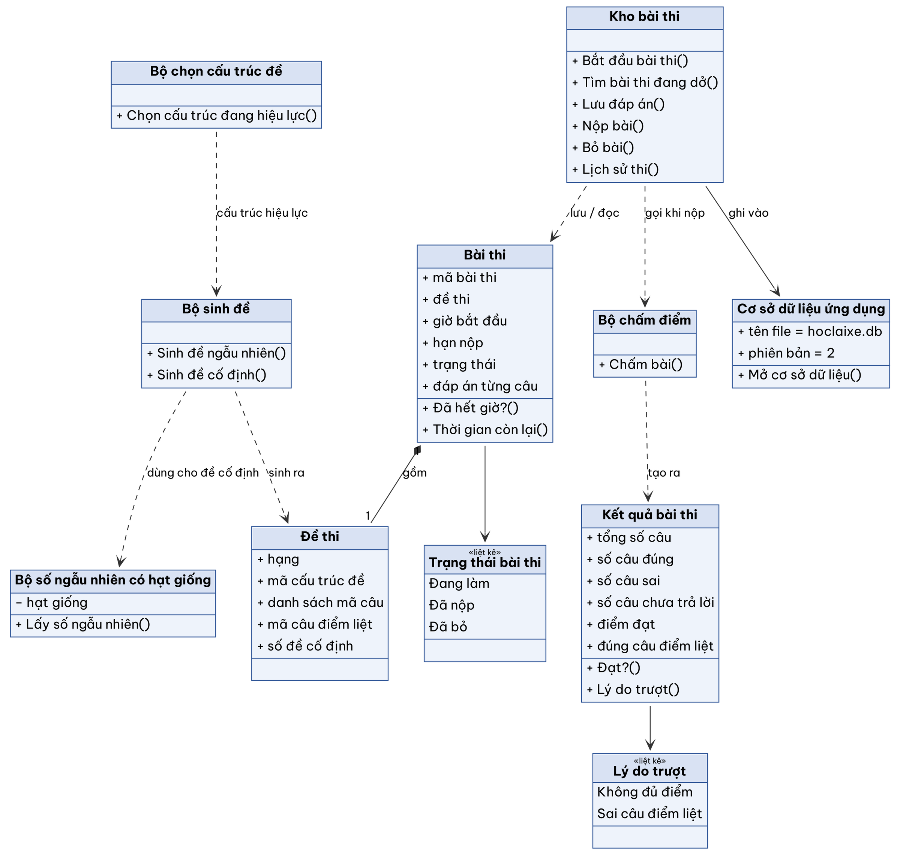

*Hình 12: Biểu đồ lớp nhóm thi thử*

### 2.4.3. Nhóm lớp tiến độ học

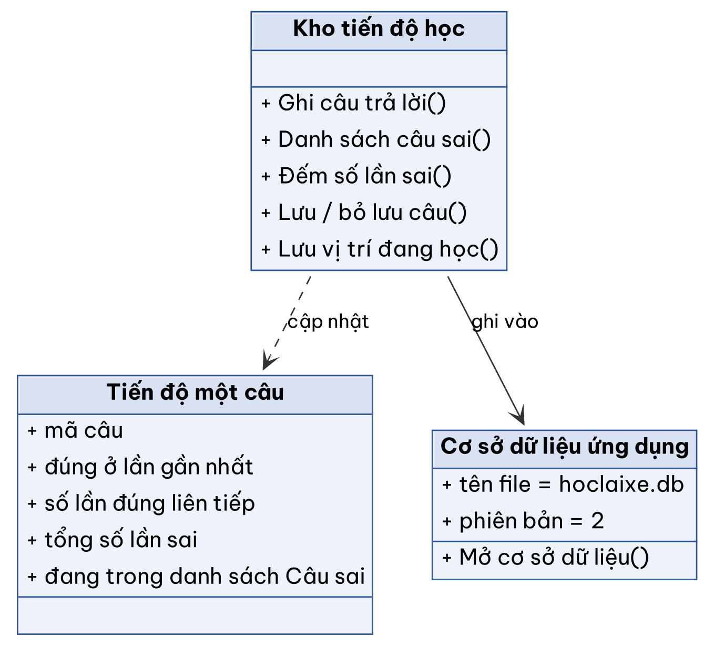

*Hình 13: Biểu đồ lớp nhóm tiến độ học*

**Bảng 2: Đối chiếu và giải thích các lớp nhóm thi thử và tiến độ học**

| **Tên trong sơ đồ**               | **Tên lớp trong code**                | **Vai trò**                                                                                                                                             |
|-----------------------------------|---------------------------------------|---------------------------------------------------------------------------------------------------------------------------------------------------------|
| Bộ chọn cấu trúc đề               | StructurePicker                       | Chọn cấu trúc đề đang có hiệu lực theo ngày hôm nay và hạng đang chọn                                                                                   |
| Bộ sinh đề                        | ExamGenerator                         | Sinh đề đúng cấu trúc: 1 câu điểm liệt + đủ số câu mỗi nhóm chương, không trùng câu; sinh 20 đề cố định                                                 |
| Bộ số ngẫu nhiên có hạt giống     | SeededRandom                          | Sinh số ngẫu nhiên từ “hạt giống” cố định, giúp mỗi đề cố định luôn ra cùng một bộ câu                                                                  |
| Đề thi                            | ExamPaper                             | Danh sách mã câu theo thứ tự và mã câu điểm liệt                                                                                                        |
| Bài thi / Trạng thái bài thi      | ExamSession / ExamStatus              | Một lần làm bài: đề, giờ bắt đầu, hạn nộp, đáp án từng câu; trạng thái Đang làm / Đã nộp / Đã bỏ                                                        |
| Kho bài thi                       | ExamSessionRepository                 | Lưu bài thi vào CSDL: bắt đầu bài, lưu đáp án ngay khi chọn, nộp bài trong một giao dịch, bỏ bài, lịch sử thi                                           |
| Bộ chấm điểm                      | ExamGrader                            | Chấm bài theo đáp án đã lưu                                                                                                                             |
| Kết quả bài thi / Lý do trượt     | ExamResult / FailReason               | Số câu đúng, sai, chưa trả lời; đạt khi đủ điểm và đúng câu điểm liệt; lý do trượt                                                                      |
| Kho tiến độ học / Tiến độ một câu | ProgressRepository / QuestionProgress | Ghi mọi lần trả lời và trạng thái từng câu (đúng gần nhất, số lần đúng liên tiếp, tổng số lần sai, có trong Câu sai không); câu đã lưu; vị trí đang học |
| Cơ sở dữ liệu ứng dụng            | AppDatabase                           | Mở file hoclaixe.db, tạo bảng và nâng cấp phiên bản CSDL (hiện là 2) mà không mất dữ liệu cũ                                                            |

## 2.5. Kiến trúc ứng dụng

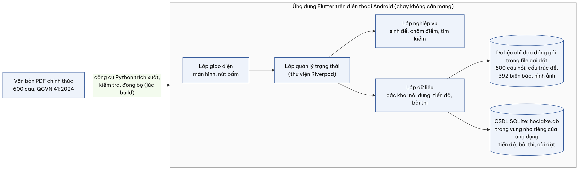

*Hình 14: Kiến trúc tổng quan của ứng dụng*

Ứng dụng **không có máy chủ (backend) và không cần mạng**. Lớp giao diện đọc/ghi trạng thái qua lớp quản lý trạng thái (thư viện Riverpod); lớp này gọi lớp nghiệp vụ (sinh đề, chấm điểm – viết bằng Dart thuần nên kiểm thử dễ) và lớp dữ liệu (các kho). Dữ liệu chia làm hai loại tách biệt: **nội dung chỉ đọc** đóng gói sẵn trong ứng dụng, và **dữ liệu của người học** lưu trong cơ sở dữ liệu SQLite trên máy.

## 2.6. Thiết kế cơ sở dữ liệu SQLite

### 2.6.1. Vì sao dùng SQLite và dữ liệu được lưu ở đâu

Các đồ án dùng MySQL hay SQL Server có một **máy chủ cơ sở dữ liệu** riêng, ứng dụng gửi câu lệnh qua mạng tới máy chủ đó. Ứng dụng của nhóm chạy offline nên dùng **SQLite**: vẫn là cơ sở dữ liệu quan hệ, vẫn tạo bảng, khóa chính, khóa ngoại và truy vấn bằng ngôn ngữ SQL, nhưng toàn bộ cơ sở dữ liệu là **một file nằm ngay trong điện thoại**, không cần máy chủ và không cần mạng. Các bảng được tạo bằng câu lệnh CREATE TABLE trong file lib/core/db/app_database.dart khi ứng dụng mở lần đầu; khi thêm bảng mới (bảng saved_question), ứng dụng tự nâng cấp CSDL từ phiên bản 1 lên 2 mà không mất dữ liệu cũ.

**Bảng 3: Nơi lưu từng loại dữ liệu của ứng dụng**

<table>
<colgroup>
<col style="width: 28%" />
<col style="width: 42%" />
<col style="width: 28%" />
</colgroup>
<thead>
<tr class="header">
<th><strong>Loại dữ liệu</strong></th>
<th><strong>Nơi lưu</strong></th>
<th><strong>Ghi chú</strong></th>
</tr>
</thead>
<tbody>
<tr class="odd">
<td>Tiến độ học, câu sai, bài thi, lịch sử, câu đã lưu, cài đặt</td>
<td>
Android: file SQLite hoclaixe.db trong thư mục riêng của ứng dụng (/data/data/com.takidang.hoclaixe/databases/)

Web: SQLite chạy bằng WebAssembly, lưu trong IndexedDB của trình duyệt
</td>
<td>Chỉ ứng dụng đọc được; gỡ ứng dụng thì mất. Đã tắt sao lưu Android</td>
</tr>
<tr class="even">
<td>600 câu hỏi, đáp án, cấu trúc đề, 392 biển báo</td>
<td>File JSON trong assets/data của ứng dụng</td>
<td>Chỉ đọc, không cần lưu trong CSDL; nạp vào bộ nhớ khi mở ứng dụng</td>
</tr>
<tr class="odd">
<td>Hình câu hỏi, hình biển báo, ảnh xe</td>
<td>assets/images của ứng dụng</td>
<td>Chỉ đọc</td>
</tr>
</tbody>
</table>

### 2.6.2. Quan hệ giữa các bảng dữ liệu

Hình dưới được vẽ tự động từ cơ sở dữ liệu thật: nhóm chạy đúng các câu lệnh CREATE TABLE của ứng dụng để tạo file hoclaixe.db rồi đọc cấu trúc bảng (tên cột, kiểu, khóa chính PK, khóa ngoại FK). Tên bảng và tên cột giữ nguyên như trong CSDL; ý nghĩa tiếng Việt ở Bảng mô tả các bảng (mục 2.6.3).

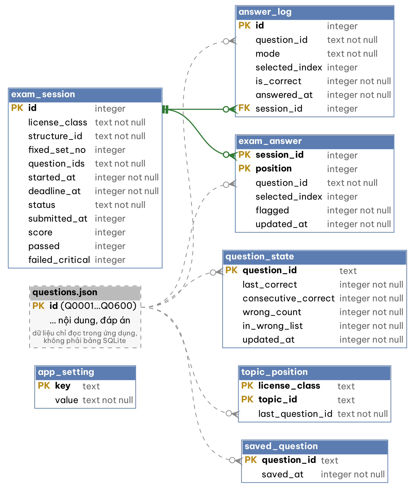

*Hình 15: Mô hình quan hệ các bảng trong cơ sở dữ liệu SQLite hoclaixe.db*

- **Đường liền màu xanh** là khóa ngoại thật trong SQLite: một bài thi (exam_session) có nhiều đáp án (exam_answer) và nhiều dòng nhật ký trả lời (answer_log); xóa bài thi thì các dòng con tự xóa theo (ON DELETE CASCADE).

- **Đường nét đứt** nối tới bộ câu hỏi questions.json: các cột question_id chứa mã câu Q0001…Q0600. Bộ câu hỏi là dữ liệu chỉ đọc đóng gói trong ứng dụng, không phải bảng SQLite, nên quan hệ này được kiểm tra trong code thay vì bằng khóa ngoại.

- Hai ràng buộc quan trọng: **tối đa một bài thi đang làm** (chỉ số duy nhất trên exam_session khi status = in_progress) và **mỗi câu của một bài thi chỉ ghi nhật ký một lần** (chỉ số duy nhất trên answer_log theo session_id, question_id) – giúp nộp bài không bị ghi trùng.

### 2.6.3. Mô tả các bảng

**Bảng 4: Mô tả các bảng trong cơ sở dữ liệu SQLite**

| **Bảng**       | **Tên tiếng Việt** | **Lưu gì**                                                                            | **Khóa**                                 |
|----------------|--------------------|---------------------------------------------------------------------------------------|------------------------------------------|
| app_setting    | Cài đặt            | Đã đồng ý miễn trừ chưa, hạng đang chọn, giao diện, Tự chuyển câu                     | PK: key                                  |
| question_state | Trạng thái câu hỏi | Đúng/sai lần gần nhất, số lần đúng liên tiếp, tổng số lần sai, có trong Câu sai không | PK: question_id                          |
| answer_log     | Nhật ký trả lời    | Mọi lần trả lời (học, ôn, thi) – nguồn cho thống kê và biểu đồ 30 ngày                | PK: id; FK: session_id                   |
| topic_position | Vị trí đang học    | Câu đang học dở của từng chủ đề theo hạng                                             | PK: license_class, topic_id              |
| exam_session   | Bài thi            | Hạng, đề, giờ bắt đầu, hạn nộp, trạng thái, điểm, đạt/không đạt                       | PK: id                                   |
| exam_answer    | Đáp án bài thi     | Đáp án từng vị trí câu, cập nhật ngay khi chọn                                        | PK: session_id, position; FK: session_id |
| saved_question | Câu đã lưu         | Các câu người học đã lưu (thêm ở phiên bản CSDL 2)                                    | PK: question_id                          |

# CHƯƠNG 3: THỰC HIỆN ĐỒ ÁN

## 3.1. Quá trình thực hiện

Nhóm thực hiện đồ án từ 03/10/2026 đến 31/10/2026. Mỗi chức năng được chia thành một story (ST-01 … ST-16) có tiêu chí chấp nhận và chỉ đóng khi có test. Giảng viên cho phép dùng AI hỗ trợ viết code; nhóm dùng Claude Code và duyệt kế hoạch trước khi code. Lịch sử thực hiện xem được trong lịch sử commit của repo.

**Bảng 5: Quá trình thực hiện**

| **Thời gian** | **Công việc**                                                                                                                                                                        |
|---------------|--------------------------------------------------------------------------------------------------------------------------------------------------------------------------------------|
| 03–06/10      | Khảo sát ứng dụng đối thủ, xác định phạm vi; xác minh văn bản chính thức; trích 600 câu hỏi từ PDF; viết đặc tả yêu cầu (SRS); soát bộ câu hỏi                                       |
| 13/10         | Thiết kế kiến trúc (6 quyết định ADR); tạo project Flutter; lõi thi thử (sinh đề, chấm điểm); chia 16 story                                                                          |
| 14/10         | Lưu trữ SQLite; miễn trừ, chọn hạng; màn chính; học theo chủ đề; ôn câu sai, câu điểm liệt; chạy được bản web; sửa 29 lỗi danh mục biển báo                                          |
| 21/10         | Thi thử trọn luồng; danh mục biển báo và tìm kiếm; thống kê                                                                                                                          |
| 22/10         | Review code và sửa 8 lỗi; chế độ Sáng/Tối/Theo máy; soát biển báo lần 2, 3; kiểm thử theo phiếu 32 mục                                                                               |
| 23/10         | Hoàn thiện danh mục vạch kẻ đường (tên vạch, hình nhóm tự vẽ)                                                                                                                        |
| 30/10         | Thêm Câu đã lưu, Tìm câu hỏi, Đọc câu hỏi; giao diện mới (nền tối, thanh 4 tab, biểu đồ 30 ngày); hiệu ứng chuyển động, Tự chuyển câu, nhấn giữ / vuốt; chạy thử trên máy ảo Android |
| 31/10         | Hoàn thiện báo cáo, sơ đồ UML                                                                                                                                                        |

## 3.2. Phân công công việc

Mã nguồn được viết với sự hỗ trợ của Claude Code; trưởng nhóm Đặng Lê Tấn Tài tích hợp và đưa code lên repo. Công việc được chia theo **module** sao cho mỗi thành viên phụ trách khoảng **8–10 chức năng** (số mục ứng với Bảng danh sách chức năng, mục 3.5), cộng thêm một việc chung của dự án và một phần báo cáo. Với module của mình, mỗi người chịu trách nhiệm: nắm yêu cầu và tiêu chí chấp nhận, kiểm thử theo phiếu, chụp ảnh minh họa, viết phần báo cáo và **giải thích được phần code** khi vấn đáp. Đường dẫn lib/ nằm trong src/app, tools/ nằm ở thư mục gốc của repo.

**Bảng 6: Phân công công việc**

<table>
<colgroup>
<col style="width: 18%" />
<col style="width: 33%" />
<col style="width: 25%" />
<col style="width: 22%" />
</colgroup>
<thead>
<tr class="header">
<th><strong>Thành viên</strong></th>
<th><strong>Chức năng phụ trách</strong></th>
<th><strong>Việc chung và phần báo cáo</strong></th>
<th><strong>File code cần nắm</strong></th>
</tr>
</thead>
<tbody>
<tr class="odd">
<td>
Đặng Lê Tấn Tài

(trưởng nhóm)
</td>
<td>Thi thử và Kết quả (mục 16–23, 42): chọn đề, sinh đề, 20 đề cố định, đồng hồ, lưu đáp án ngay khi chọn, bảng thoát, tiếp tục bài dở, chấm điểm, xem lại bài</td>
<td>
Kiến trúc ứng dụng, CSDL SQLite, tích hợp code lên repo

Báo cáo: 2.3, 2.5, 2.6, 3.7.6–3.7.8
</td>
<td>
lib/features/exam/

lib/core/db/

lib/core/router.dart

lib/main.dart
</td>
</tr>
<tr class="even">
<td>Nguyễn Đỗ Tuấn Kiệt</td>
<td>Dữ liệu và Biển báo (mục 24–26, 40–41, 43): trích 600 câu, 293 hình, 392 biển từ PDF; validator; danh mục, chi tiết, tìm biển; chạy offline, bản web; kiểm thử trên máy thật</td>
<td>
Review code, phiếu kiểm thử 32 mục

Báo cáo: 3.4, Chương 4, 3.7.9
</td>
<td>
tools/extract_*, tools/validate_data

lib/core/content/

lib/features/signs/
</td>
</tr>
<tr class="odd">
<td>Lê Tiến Đạt</td>
<td>Khởi đầu, Tổng quan, Giao diện (mục 1–7, 35, 36, 38): màn mở đầu, miễn trừ, chọn / đổi hạng, màn chính, thanh 4 tab, Giới thiệu, Sáng/Tối, cỡ chữ 130%</td>
<td>
Thiết kế giao diện, màu, font

Báo cáo: Chương 1, 2.1, 3.7.1–3.7.3, 3.7.14
</td>
<td>
lib/features/onboarding/, home/, about/

lib/core/settings/, core/theme/

lib/shared/widgets/app_shell.dart
</td>
</tr>
<tr class="even">
<td>Nguyễn Phan Gia An</td>
<td>Học và Ôn tập (mục 8–15, 34, 37): học theo chủ đề, chấm ngay, lưới số câu, phóng to hình, ôn câu sai, câu điểm liệt, câu hay sai, nhấn giữ thẻ chủ đề, Tự chuyển câu</td>
<td>
Quy tắc danh sách Câu sai

Báo cáo: 2.2, 3.5, 3.7.4–3.7.5, Chương 6
</td>
<td>
lib/features/study/ (topic_list, study_screen, progress_repository)

lib/shared/widgets/question_view.dart, answer_option.dart
</td>
</tr>
<tr class="odd">
<td>Lê Việt Đức</td>
<td>Thống kê và Tiện ích (mục 27–33, 39): thống kê, lịch sử thi, biểu đồ 30 ngày, câu đã lưu, vuốt bỏ lưu, tìm câu hỏi, đọc câu hỏi, hiệu ứng chuyển động</td>
<td>
Chụp ảnh màn hình cho báo cáo

Báo cáo: 2.4, 3.7.10–3.7.13, Chương 5
</td>
<td>
lib/features/stats/

lib/features/study/ (saved_screen, question_search)

lib/core/speech/

lib/shared/widgets/motion.dart
</td>
</tr>
</tbody>
</table>

## 3.3. Công nghệ sử dụng và link Git dự án

**Link Git dự án (công khai):** https://github.com/takidang/hoclaixe – mã nguồn ứng dụng Flutter nằm trong thư mục **src/app**; dữ liệu đã trích trong data/, công cụ trích xuất và kiểm tra trong tools/, tài liệu đặc tả và kiến trúc trong docs/.

**Bảng 7: Công nghệ và thư viện sử dụng**

| **Thành phần**   | **Công nghệ / Thư viện**                                   | **Mục đích sử dụng**                                                                   |
|------------------|------------------------------------------------------------|----------------------------------------------------------------------------------------|
| Mobile App       | Flutter 3.47 / Dart 3.13, Material 3                       | Xây dựng ứng dụng Android; cùng mã nguồn chạy được trên trình duyệt (Flutter Web)      |
| Backend/API      | Không sử dụng                                              | Ứng dụng chạy 100% offline, không gọi mạng                                             |
| Cơ sở dữ liệu    | SQLite qua sqflite (Android), sqflite_common_ffi_web (Web) | Lưu tiến độ học, danh sách câu sai, bài thi, lịch sử thi, câu đã lưu, cài đặt trên máy |
| Dữ liệu nội dung | JSON và hình ảnh đóng gói trong assets                     | 600 câu hỏi, cấu trúc đề thi, 392 biển báo và vạch kẻ đường                            |
| Authentication   | Không sử dụng                                              | Không cần tài khoản, không thu thập dữ liệu người dùng                                 |
| State Management | Riverpod 3 (flutter_riverpod)                              | Quản lý trạng thái nội dung, cài đặt, tiến độ, bài thi                                 |
| Điều hướng       | go_router                                                  | Chuyển màn hình; thanh 4 tab giữ trạng thái riêng của từng tab                         |
| Đọc văn bản      | flutter_tts                                                | Đọc câu hỏi và đáp án bằng giọng tiếng Việt của máy                                    |
| Kiểm thử         | flutter_test, sqflite_common_ffi                           | Unit test và widget test chạy trên dữ liệu thật và SQLite thật trong bộ nhớ            |
| Xử lý dữ liệu    | Python 3, PyMuPDF                                          | Trích câu hỏi, đáp án, hình, biển báo từ file PDF chính thức                           |

## 3.4. Xây dựng dữ liệu

Toàn bộ câu hỏi, đáp án, hình và biển báo được lấy nguyên văn từ văn bản chính thức (Tài liệu tham khảo \[1\]–\[6\]) theo năm bước:

- **Trích tự động** từ PDF chính thức bằng Python và PyMuPDF: đủ 600 câu, 293 hình; đáp án đúng lấy từ phần gạch chân trong PDF.

- **Kiểm tra tự động** bằng chương trình validator: đủ câu, đúng chương, câu có nhắc tới hình thì phải có hình, tên biển không bị cắt dở. Validator phải đạt trước mỗi bản build.

- **Soát bằng tay, không dùng AI**: trang HTML đặt PDF gốc cạnh dữ liệu ứng dụng; dò lại phần gạch chân bằng xử lý ảnh, khớp 600/600 đáp án.

- **Đồng bộ vào ứng dụng** kèm mã băm SHA-256 từng file; một test so mã băm nên quên đồng bộ là test báo lỗi.

- **Mã câu cố định** Q0001…Q0600, không tái sử dụng, nên cập nhật dữ liệu không làm mất tiến độ của người học.

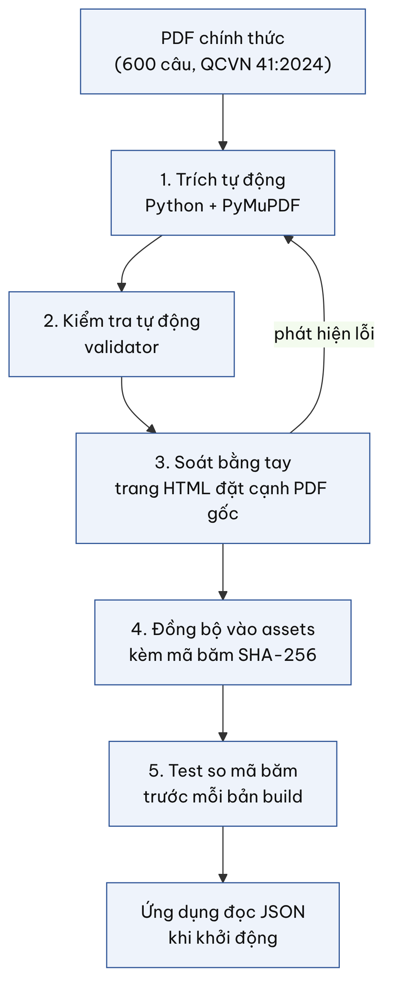

*Hình 16: Quy trình xây dựng và kiểm tra dữ liệu*

## 3.5. Tổng hợp các chức năng

Ứng dụng có một loại người dùng là người học, nên chức năng được phân nhóm theo **module**. Hai mục cuối bảng chưa hoàn thiện và được ghi rõ trạng thái.

**Bảng 8: Danh sách chức năng của ứng dụng**

| **STT** | **Module**      | **Chức năng**                                                                                                                   | **Trạng thái**  |
|---------|-----------------|---------------------------------------------------------------------------------------------------------------------------------|-----------------|
| 1       | Khởi đầu        | Màn mở đầu có ảnh xe và nút “Bắt đầu”                                                                                           | Hoàn thành      |
| 2       | Khởi đầu        | Tuyên bố miễn trừ lần đầu kèm danh sách nguồn dữ liệu                                                                           | Hoàn thành      |
| 3       | Khởi đầu        | Chọn hạng A1 / A / B (mô tả loại xe, số câu, thời gian, điểm đạt)                                                               | Hoàn thành      |
| 4       | Khởi đầu        | Đổi hạng; hỏi xác nhận nếu đang có bài thi dở                                                                                   | Hoàn thành      |
| 5       | Tổng quan       | Tiến độ ôn tập và lối vào các chức năng                                                                                         | Hoàn thành      |
| 6       | Tổng quan       | Thẻ “Tiếp tục bài thi” khi có bài đang làm dở                                                                                   | Hoàn thành      |
| 7       | Tổng quan       | Thanh 4 tab: Tổng quan, Học, Câu đã lưu, Thống kê (mỗi tab giữ trạng thái)                                                      | Hoàn thành      |
| 8       | Học theo chủ đề | Chọn chủ đề (tất cả, câu điểm liệt, 6 chương), hiện số câu đúng / sai / chưa làm                                                | Hoàn thành      |
| 9       | Học theo chủ đề | Chọn đáp án hiện ngay đúng / sai, khóa câu                                                                                      | Hoàn thành      |
| 10      | Học theo chủ đề | Lưới số câu để nhảy câu, nhớ câu đang học dở                                                                                    | Hoàn thành      |
| 11      | Học theo chủ đề | Làm lại chủ đề (không xóa tiến độ), tóm tắt cuối chủ đề                                                                         | Hoàn thành      |
| 12      | Học theo chủ đề | Phóng to hình câu hỏi (tối đa 4 lần)                                                                                            | Hoàn thành      |
| 13      | Ôn tập          | Ôn câu sai (ra khỏi danh sách khi đúng 2 lần liên tiếp)                                                                         | Hoàn thành      |
| 14      | Ôn tập          | Ôn câu điểm liệt theo hạng (A1/A: 20 câu, B: 60 câu)                                                                            | Hoàn thành      |
| 15      | Ôn tập          | Câu hay sai (tối đa 50 câu sai nhiều nhất)                                                                                      | Hoàn thành      |
| 16      | Thi thử         | Đề ngẫu nhiên đúng cấu trúc đề thi theo hạng                                                                                    | Hoàn thành      |
| 17      | Thi thử         | 20 đề cố định (mỗi đề luôn ra cùng bộ câu), hiện trạng thái và điểm từng đề                                                     | Hoàn thành      |
| 18      | Thi thử         | Đồng hồ đếm ngược, hết giờ tự nộp bài                                                                                           | Hoàn thành      |
| 19      | Thi thử         | Đổi đáp án tự do, không lộ đúng/sai, lưu đáp án ngay khi chọn                                                                   | Hoàn thành      |
| 20      | Thi thử         | Bảng thoát 4 lựa chọn (nộp, lưu tạm, không lưu, tiếp tục)                                                                       | Hoàn thành      |
| 21      | Thi thử         | Tiếp tục bài thi dở sau khi tắt ứng dụng; quá giờ thì tự nộp                                                                    | Hoàn thành      |
| 22      | Kết quả         | ĐẠT / KHÔNG ĐẠT, số câu đúng / sai / chưa trả lời, lý do trượt                                                                  | Hoàn thành      |
| 23      | Kết quả         | Xem lại bài, lọc “Chỉ câu sai”                                                                                                  | Hoàn thành      |
| 24      | Biển báo        | Danh mục 392 biển báo và vạch kẻ đường, 7 nhóm theo QCVN 41:2024                                                                | Hoàn thành      |
| 25      | Biển báo        | Chi tiết biển (hình, mã, tên, mô tả theo QCVN)                                                                                  | Hoàn thành      |
| 26      | Biển báo        | Tìm biển theo mã hoặc tên, gõ không dấu                                                                                         | Hoàn thành      |
| 27      | Thống kê        | Số lần thi, tỉ lệ đạt, điểm gần nhất, tiến độ theo chủ đề                                                                       | Hoàn thành      |
| 28      | Thống kê        | Lịch sử thi, chạm để xem lại bài                                                                                                | Hoàn thành      |
| 29      | Thống kê        | Biểu đồ số câu đã làm mỗi ngày trong 30 ngày, chuỗi ngày học liên tiếp                                                          | Hoàn thành      |
| 30      | Câu đã lưu      | Lưu câu muốn xem lại, ôn trong tab riêng                                                                                        | Hoàn thành      |
| 31      | Câu đã lưu      | Vuốt để bỏ lưu, có nút Hoàn tác                                                                                                 | Hoàn thành      |
| 32      | Tìm câu hỏi     | Tìm theo số câu hoặc từ khóa, gõ không dấu                                                                                      | Hoàn thành      |
| 33      | Đọc câu hỏi     | Đọc câu hỏi và đáp án bằng giọng tiếng Việt của máy                                                                             | Hoàn thành      |
| 34      | Học theo chủ đề | Nhấn giữ thẻ chủ đề: Học tiếp / Ôn câu sai / Làm lại từ đầu                                                                     | Hoàn thành      |
| 35      | Giới thiệu      | Thông tin ứng dụng, nguồn dữ liệu chính thức, nguồn ảnh                                                                         | Hoàn thành      |
| 36      | Giao diện       | Chế độ Sáng / Tối / Theo máy                                                                                                    | Hoàn thành      |
| 37      | Giao diện       | Tự chuyển câu (bật ở Giới thiệu hoặc nút ⏩ khi đang làm)                                                                       | Hoàn thành      |
| 38      | Giao diện       | Không vỡ bố cục khi cỡ chữ hệ thống 130%, vùng chạm ≥ 48dp                                                                      | Hoàn thành      |
| 39      | Giao diện       | Hiệu ứng chuyển động, rung phản hồi; tự tắt khi máy bật giảm chuyển động                                                        | Hoàn thành      |
| 40      | Riêng tư        | Chạy offline, không đăng nhập, tiến độ chỉ lưu trên máy                                                                         | Hoàn thành      |
| 41      | Nền tảng        | Chạy trên trình duyệt (Flutter Web) từ cùng mã nguồn                                                                            | Hoàn thành      |
| 42      | Thi thử         | Bấm rất nhanh qua nhiều câu trong lúc đang lưu có thể mất lựa chọn ở câu giữa (không làm sai điểm; câu đó hiện là chưa trả lời) | Chưa ổn định    |
| 43      | Kiểm thử        | Kiểm thử đầy đủ trên điện thoại thật                                                                                            | Chưa hoàn thiện |

## 3.6. Hướng dẫn chạy ứng dụng

Nhóm nộp mã nguồn (không đóng gói bản APK). Để chạy ứng dụng:

1.  Cài Flutter 3.47 (kèm Android Studio hoặc trình duyệt Chrome). Kiểm tra bằng lệnh **flutter doctor**.

2.  Tải mã nguồn: **git clone https://github.com/takidang/hoclaixe.git** (Windows nên thêm -c core.longpaths=true).

3.  Vào thư mục ứng dụng: **cd hoclaixe/src/app**, chạy **flutter pub get**.

4.  Chạy trên trình duyệt (nhanh, không cần máy ảo): **flutter run -d chrome --web-port 8080**; hoặc trên máy ảo / điện thoại Android đã bật gỡ lỗi USB: **flutter run**.

5.  Chạy toàn bộ kiểm thử tự động: **flutter test**.

6.  Để dùng Đọc câu hỏi trên Android, máy cần giọng tiếng Việt: Cài đặt → Hệ thống → Ngôn ngữ → Chuyển văn bản thành giọng nói → tải gói Tiếng Việt.

## 3.7. Minh họa chi tiết các chức năng (hướng dẫn sử dụng)

Mỗi chức năng được trình bày theo thứ tự: **ảnh giao diện → mô tả → cách thao tác → kết quả ứng dụng xử lý**, để người mới đọc có thể làm theo ngay. Ảnh được chụp từ ứng dụng thật ở kích thước màn hình điện thoại (1080 × 2340) bằng công cụ chụp màn hình tự động của nhóm (widget test dùng font và dữ liệu thật), ngày 30/10/2026.

### 3.7.1. Màn hình mở đầu và tuyên bố miễn trừ

<table>
<colgroup>
<col style="width: 50%" />
<col style="width: 50%" />
</colgroup>
<tbody>
<tr class="odd">
<td>

<em>(a) Giao diện tối</em>
</td>
<td>

<em>(b) Giao diện sáng</em>
</td>
</tr>
</tbody>
</table>

*Hình 17: Màn hình mở đầu*

**Mô tả:** Màn đầu tiên khi cài ứng dụng: ảnh xe, tên “Ôn thi lý thuyết lái xe”, dòng “Bộ 600 câu hỏi chính thức · Hạng A1, A và B” và nút **Bắt đầu**.

**Cách thao tác:**

1.  Mở ứng dụng lần đầu.

2.  Bấm **Bắt đầu**.

3.  Đọc tuyên bố miễn trừ (ứng dụng là sản phẩm học tập độc lập, không đại diện cơ quan nhà nước, kèm danh sách văn bản nguồn) và bấm **Đồng ý**.

**Kết quả:** Lựa chọn “đã đồng ý” được lưu vào SQLite; từ lần mở sau ứng dụng vào thẳng màn hình chính, không hỏi lại.

**\[CẦN BỔ SUNG\]** Ảnh màn tuyên bố miễn trừ (chụp trên máy ảo khi cài mới).

### 3.7.2. Chọn hạng bằng lái

<table>
<colgroup>
<col style="width: 100%" />
</colgroup>
<tbody>
<tr class="odd">
<td>
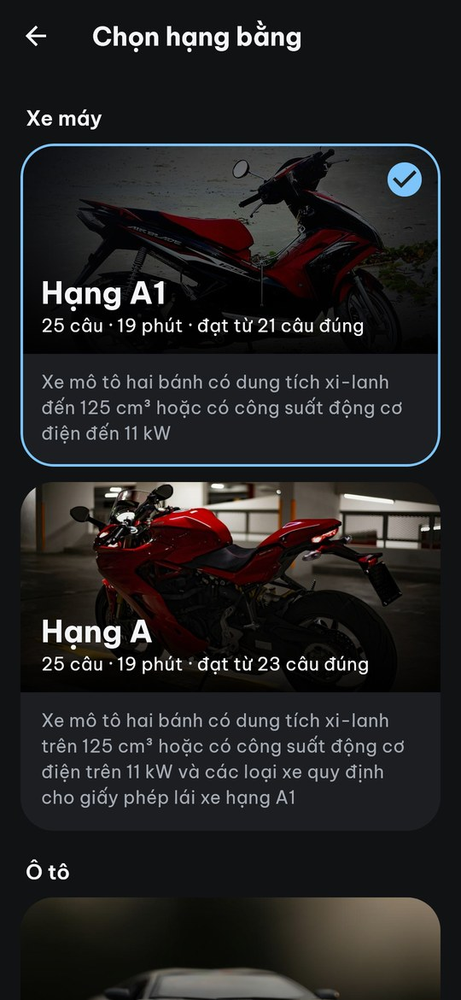

<em>Màn chọn hạng</em>
</td>
</tr>
</tbody>
</table>

*Hình 18: Màn hình chọn hạng bằng*

**Mô tả:** Các hạng chia hai nhóm **Xe máy** (A1, A) và **Ô tô** (B). Mỗi thẻ ghi số câu, thời gian, điểm đạt (ví dụ hạng A1: 25 câu · 19 phút · đạt từ 21 câu đúng) và mô tả loại xe trích nguyên văn Điều 57 Luật 36/2024/QH15.

**Cách thao tác:**

1.  Chạm vào thẻ hạng muốn ôn (ví dụ Hạng A1).

2.  Muốn đổi hạng sau này: ở màn hình chính bấm nút **Đổi hạng** ở góc trên.

**Kết quả:** Hạng đang chọn có dấu tích và được lưu lại. Nếu đổi hạng khi đang có bài thi dở của hạng khác, ứng dụng hỏi “Bỏ bài thi đang làm?” trước khi đổi.

### 3.7.3. Màn hình chính (Tổng quan)

<table>
<colgroup>
<col style="width: 50%" />
<col style="width: 50%" />
</colgroup>
<tbody>
<tr class="odd">
<td>
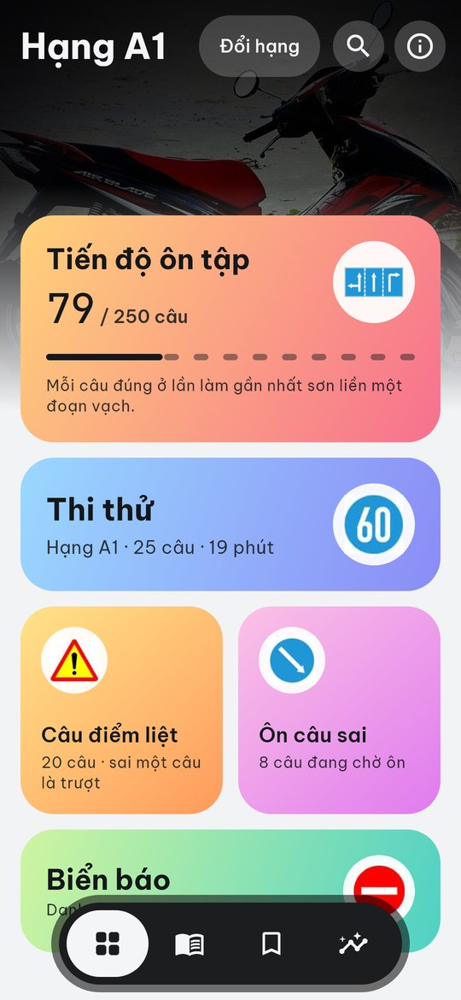

<em>(a) Giao diện sáng</em>
</td>
<td>
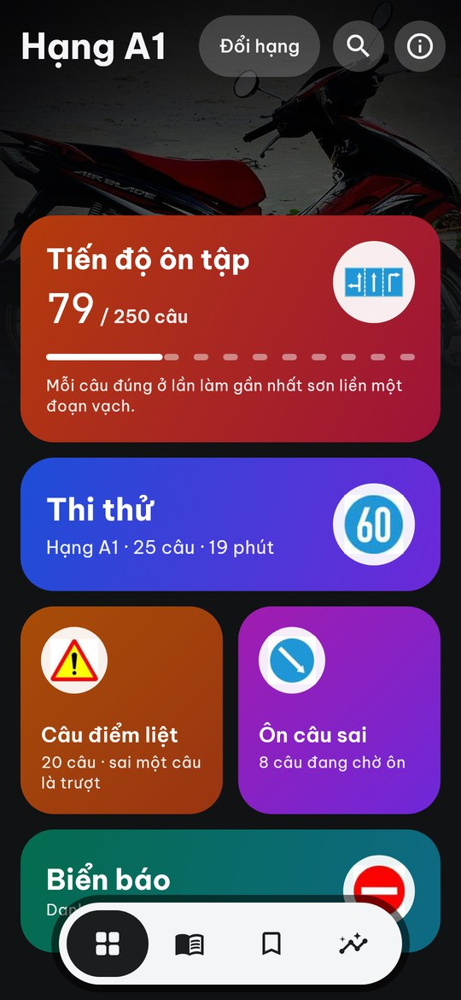

<em>(b) Giao diện tối</em>
</td>
</tr>
</tbody>
</table>

*Hình 19: Màn hình chính*

**Mô tả:** Màn hình chính hiện hạng đang ôn và thẻ **Tiến độ ôn tập** (ví dụ 79/250 câu); mỗi câu đúng ở lần làm gần nhất “sơn liền” một đoạn vạch kẻ đường. Bên dưới là lối vào Thi thử (ghi số câu và thời gian của hạng), Câu điểm liệt, Ôn câu sai (ghi số câu đang chờ ôn) và Biển báo. Góc trên có nút Đổi hạng, Tìm câu hỏi và Giới thiệu.

**Cách thao tác:**

1.  Chạm một thẻ để vào chức năng tương ứng.

2.  Dùng thanh 4 tab nổi ở đáy màn hình để chuyển giữa **Tổng quan, Học, Câu đã lưu, Thống kê**.

3.  Khi có bài thi dở, chạm thẻ **Tiếp tục bài thi** để làm tiếp.

**Kết quả:** Mỗi tab giữ nguyên vị trí đang xem khi chuyển qua lại; nút Back của Android ở tab khác sẽ đưa về tab Tổng quan trước khi thoát ứng dụng.

### 3.7.4. Học theo chủ đề

<table>
<colgroup>
<col style="width: 33%" />
<col style="width: 33%" />
<col style="width: 33%" />
</colgroup>
<tbody>
<tr class="odd">
<td>
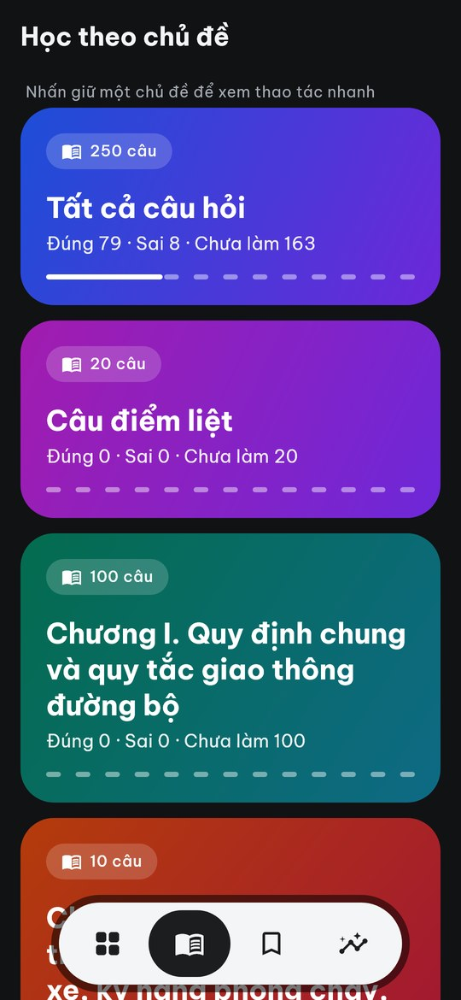

<em>(a) Danh sách chủ đề</em>
</td>
<td>
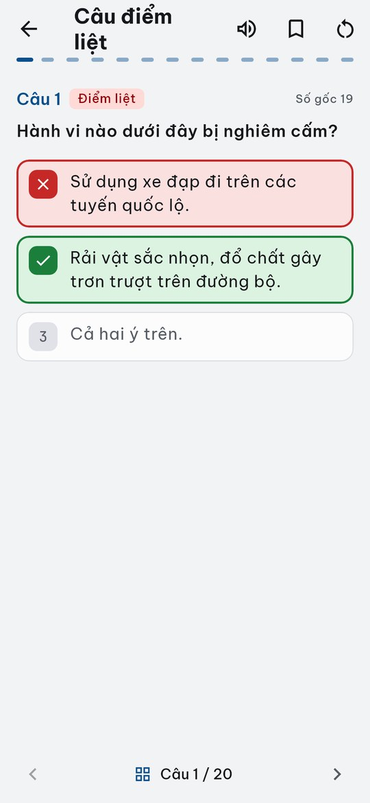

<em>(b) Chọn sai</em>
</td>
<td>
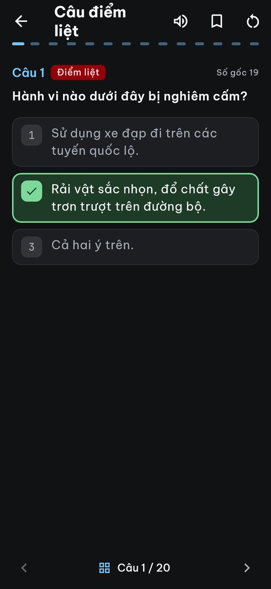

<em>(c) Chọn đúng</em>
</td>
</tr>
</tbody>
</table>

*Hình 20: Học theo chủ đề*

**Mô tả:** Tab Học liệt kê: Tất cả câu hỏi, Câu điểm liệt và 6 chương của bộ đề. Mỗi thẻ ghi số câu theo hạng và tiến độ “Đúng · Sai · Chưa làm” (ví dụ Đúng 79 · Sai 8 · Chưa làm 163). Mỗi câu ghi số thứ tự trong chủ đề, **số câu gốc** trong bộ 600 câu và nhãn “Điểm liệt” nếu có.

**Cách thao tác:**

1.  Mở tab **Học**, chạm một thẻ chủ đề (nhấn giữ thẻ để chọn nhanh Học tiếp / Ôn câu sai / Làm lại từ đầu).

2.  Đọc câu hỏi và chạm một đáp án.

3.  Bấm mũi tên ở thanh dưới để sang câu, hoặc bấm nút lưới số câu để nhảy tới câu bất kỳ.

4.  Câu có hình: chạm hình để mở xem lớn, chạm đúp hoặc chụm hai ngón để phóng to tối đa 4 lần.

**Kết quả:** Ứng dụng chấm ngay: chọn sai thì đáp án đó tô đỏ có dấu ✗ và đáp án đúng tô xanh có dấu ✓; chọn đúng thì chỉ tô xanh. Câu đã trả lời bị khóa. Lần sau mở lại chủ đề, ứng dụng mở đúng câu đang học dở. Hết chủ đề, ứng dụng hiện bảng tóm tắt số câu đúng, sai và gợi ý ôn các câu sai của chủ đề.

### 3.7.5. Ôn câu sai, câu điểm liệt và câu hay sai

**Mô tả:** Ba chức năng ôn tập mở từ màn hình chính và màn Thống kê, dùng chung giao diện làm câu hỏi ở mục 3.7.4:

- **Ôn câu sai:** mọi câu trả lời sai (khi học hoặc thi) và câu bỏ trống khi nộp bài thi được đưa vào danh sách. Câu chỉ ra khỏi danh sách khi người dùng trả lời **đúng 2 lần liên tiếp** (Hình dưới).

- **Câu điểm liệt:** ôn riêng các câu điểm liệt của hạng (A1, A: 20 câu; B: 60 câu). Sai câu điểm liệt khi thi là trượt dù đủ điểm.

- **Câu hay sai:** tối đa 50 câu người dùng sai nhiều lần nhất, xếp theo tổng số lần sai.

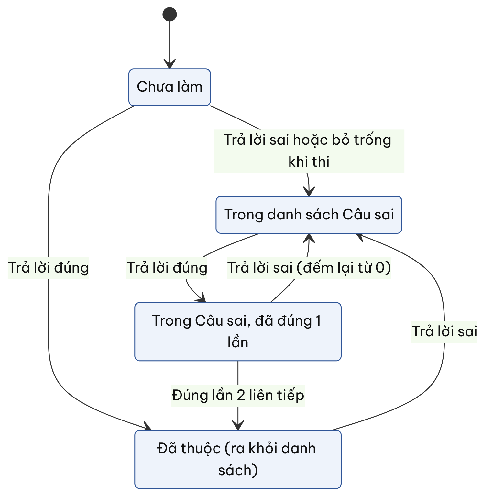

*Hình 21: Quy tắc đưa câu vào và ra khỏi danh sách Ôn câu sai*

**Kết quả:** Khi danh sách câu sai trống, ứng dụng hiện “Bạn chưa có câu sai” và gợi ý làm một bài thi thử.

### 3.7.6. Thi thử: chọn đề và thông tin đề

<table>
<colgroup>
<col style="width: 50%" />
<col style="width: 50%" />
</colgroup>
<tbody>
<tr class="odd">
<td>
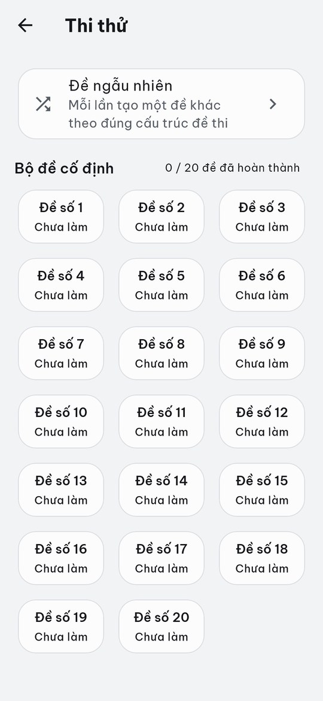

<em>(a) Chọn đề</em>
</td>
<td>
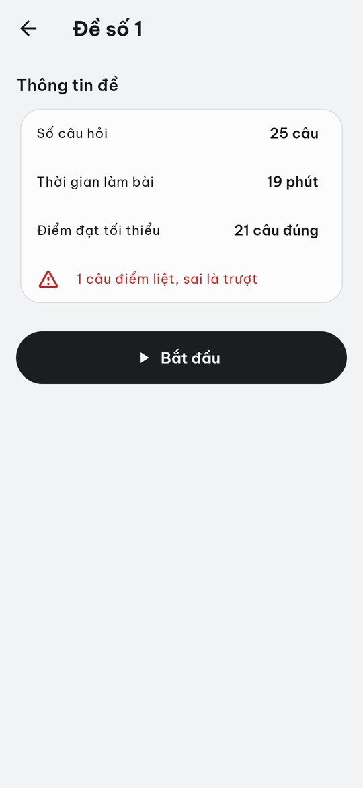

<em>(b) Thông tin đề</em>
</td>
</tr>
</tbody>
</table>

*Hình 22: Thi thử: chọn đề và thông tin đề*

**Mô tả:** Có **Đề ngẫu nhiên** (mỗi lần một đề khác, đúng cấu trúc đề thi của hạng) và **20 đề cố định** (mỗi đề luôn ra cùng bộ câu nên làm lại được để so sánh). Mỗi ô đề ghi trạng thái Chưa làm / Đạt / Chưa đạt, dòng trên đếm “x / 20 đề đã hoàn thành”.

**Cách thao tác:**

1.  Ở màn hình chính bấm **Thi thử**.

2.  Chạm **Đề ngẫu nhiên** hoặc một ô đề cố định.

3.  Đọc thông tin đề: số câu, thời gian làm bài, điểm đạt tối thiểu và cảnh báo “1 câu điểm liệt, sai là trượt”.

4.  Bấm **Bắt đầu**.

**Kết quả:** Ứng dụng sinh đề, lưu bài thi và hạn nộp vào SQLite rồi mở màn làm bài.

### 3.7.7. Thi thử: làm bài và kết thúc bài thi

<table>
<colgroup>
<col style="width: 50%" />
<col style="width: 50%" />
</colgroup>
<tbody>
<tr class="odd">
<td>
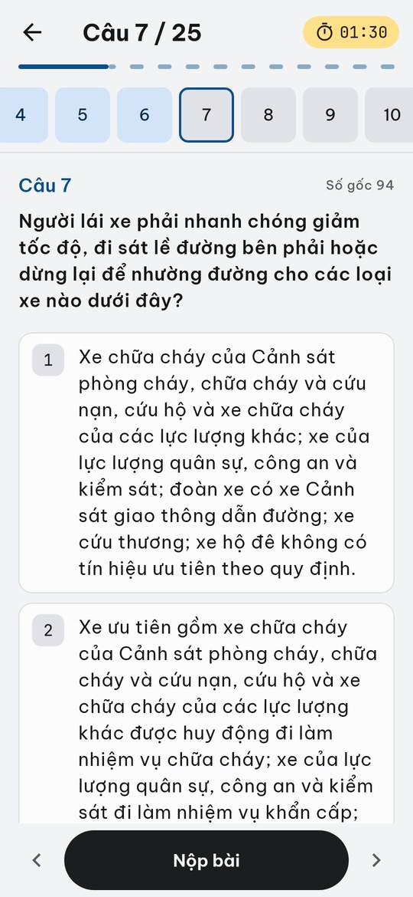

<em>(a) Màn làm bài</em>
</td>
<td>
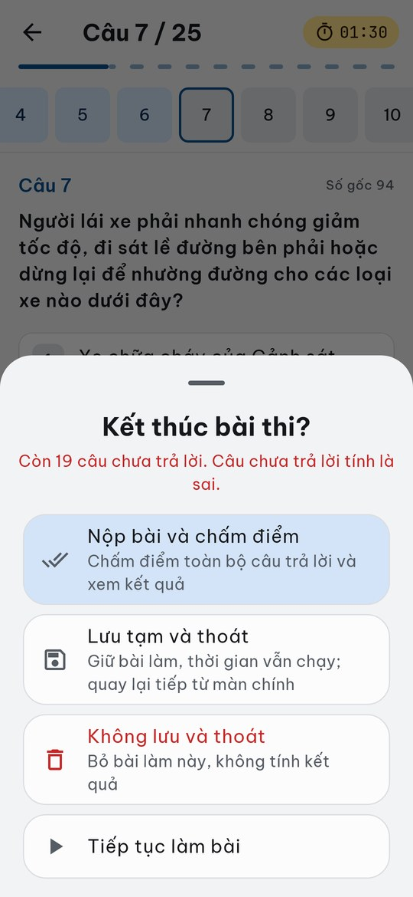

<em>(b) Bảng Kết thúc bài thi?</em>
</td>
</tr>
</tbody>
</table>

*Hình 23: Thi thử: làm bài và kết thúc bài thi*

**Mô tả:** Màn làm bài có đồng hồ đếm ngược ở góc trên (chuyển vàng khi còn dưới 2 phút, đỏ khi còn dưới 60 giây) và dải số câu cho biết câu nào đã trả lời. Giống phần mềm sát hạch thật, ứng dụng **không hiện đúng/sai và không hiện nhãn điểm liệt** khi đang thi.

**Cách thao tác:**

1.  Chạm đáp án; có thể đổi đáp án bao nhiêu lần tùy ý trước khi nộp.

2.  Chuyển câu bằng mũi tên hoặc chạm số trên dải số câu.

3.  Bấm **Nộp bài** (hoặc nút Back) để mở bảng **Kết thúc bài thi?** với 4 lựa chọn: Nộp bài và chấm điểm; Lưu tạm và thoát (thời gian vẫn chạy); Không lưu và thoát; Tiếp tục làm bài.

**Kết quả:** Mỗi đáp án được lưu vào cơ sở dữ liệu ngay khi chọn, nên tắt ứng dụng giữa chừng cũng không mất (xem biểu đồ tuần tự mục 2.3.3). Hết giờ, bài được nộp tự động. Mở lại ứng dụng khi còn bài dở, ứng dụng hỏi có tiếp tục không; nếu bài đã quá giờ thì tự nộp và hiện kết quả.

### 3.7.8. Kết quả và xem lại bài thi

<table>
<colgroup>
<col style="width: 100%" />
</colgroup>
<tbody>
<tr class="odd">
<td>
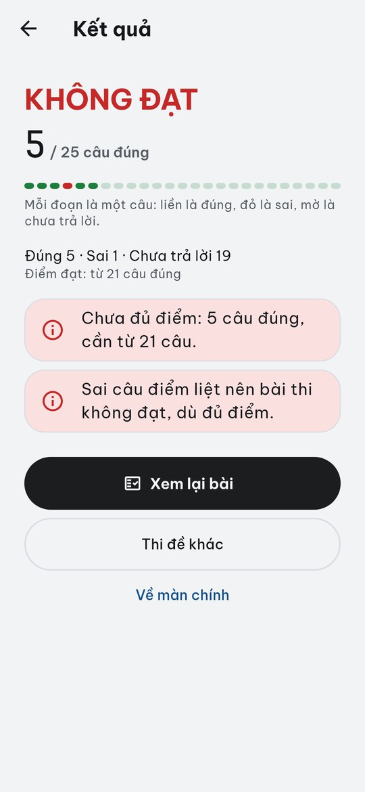

<em>Màn Kết quả</em>
</td>
</tr>
</tbody>
</table>

*Hình 24: Kết quả bài thi (trường hợp KHÔNG ĐẠT)*

**Mô tả:** Sau khi nộp, ứng dụng hiện **ĐẠT** hoặc **KHÔNG ĐẠT**, số câu đúng trên tổng số câu, dải màu từng câu (xanh đúng, đỏ sai, mờ chưa trả lời), số câu đúng · sai · chưa trả lời và điểm đạt của hạng.

**Cách thao tác:**

1.  Đọc kết quả và lý do trượt (nếu có).

2.  Bấm **Xem lại bài** để xem từng câu với đáp án đã chọn và đáp án đúng; bật bộ lọc **Chỉ câu sai** để chỉ xem câu làm sai.

3.  Bấm **Thi đề khác** hoặc **Về màn chính**.

**Kết quả:** Khi trượt, ứng dụng nêu rõ lý do: chưa đủ điểm (ví dụ “5 câu đúng, cần từ 21 câu”) hoặc sai câu điểm liệt. Bài chỉ đạt khi đủ điểm **và** đúng câu điểm liệt. Các câu sai và câu bỏ trống được đưa vào danh sách Ôn câu sai.

### 3.7.9. Tra cứu biển báo

<table>
<colgroup>
<col style="width: 50%" />
<col style="width: 50%" />
</colgroup>
<tbody>
<tr class="odd">
<td>
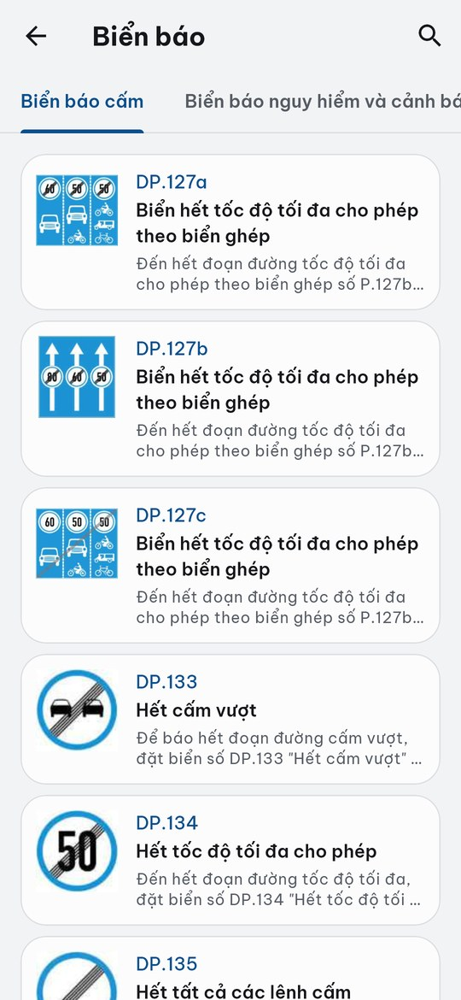

<em>(a) Danh mục</em>
</td>
<td>
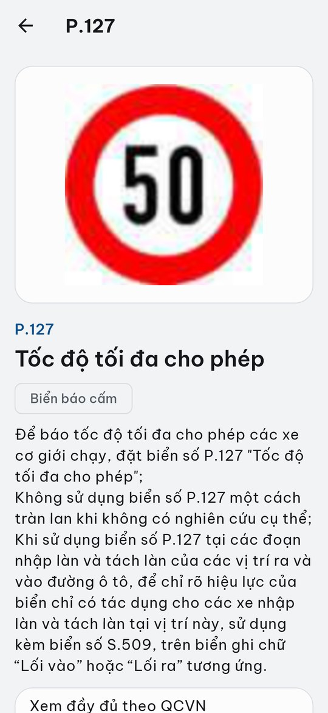

<em>(b) Chi tiết biển</em>
</td>
</tr>
</tbody>
</table>

*Hình 25: Tra cứu biển báo*

**Mô tả:** Danh mục gồm **392 biển báo và vạch kẻ đường**, chia 7 tab theo QCVN 41:2024: biển báo cấm, nguy hiểm và cảnh báo, hiệu lệnh, chỉ dẫn, biển phụ, chỉ dẫn trên đường cao tốc, vạch kẻ đường. Mỗi dòng có hình, mã, tên và mô tả ngắn.

**Cách thao tác:**

1.  Ở màn hình chính bấm **Biển báo**.

2.  Vuốt ngang hoặc chạm tab để chọn nhóm biển.

3.  Chạm một biển để xem chi tiết.

4.  Bấm biểu tượng kính lúp, gõ mã hoặc tên biển (gõ không dấu cũng được).

**Kết quả:** Màn chi tiết hiện hình lớn, mã, tên, nhóm biển và đoạn mô tả đầy đủ trích từ QCVN. Ví dụ gõ “quay dau” ra P.124a Cấm quay đầu xe. Ba vạch 3.2, 3.3, 3.4 không có hình riêng trong QCVN nên dùng hình nhóm tự vẽ, có ghi chú dưới hình.

### 3.7.10. Thống kê

<table>
<colgroup>
<col style="width: 50%" />
<col style="width: 50%" />
</colgroup>
<tbody>
<tr class="odd">
<td>
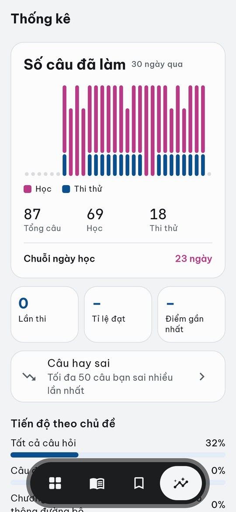

<em>(a) Giao diện sáng</em>
</td>
<td>
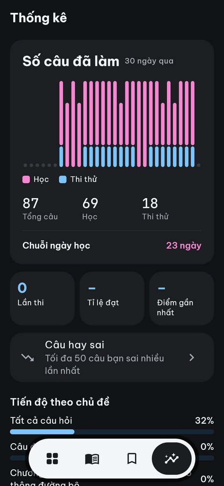

<em>(b) Giao diện tối</em>
</td>
</tr>
</tbody>
</table>

*Hình 26: Màn hình Thống kê*

**Mô tả:** Tab Thống kê có biểu đồ số câu đã làm mỗi ngày trong 30 ngày qua (tách màu phần học và phần thi thử), tổng số câu, số câu học, số câu thi và **chuỗi ngày học liên tiếp**. Bên dưới là số lần thi, tỉ lệ đạt, điểm gần nhất, lối vào Câu hay sai, tiến độ theo từng chủ đề và lịch sử thi.

**Cách thao tác:**

1.  Chạm tab **Thống kê** ở thanh tab.

2.  Chạm **Câu hay sai** để ôn các câu sai nhiều nhất.

3.  Chạm một bài trong lịch sử thi để xem lại bài đó.

**Kết quả:** Số liệu được tính từ nhật ký trả lời trong SQLite nên luôn khớp với những gì người học đã làm.

### 3.7.11. Câu đã lưu

<table>
<colgroup>
<col style="width: 100%" />
</colgroup>
<tbody>
<tr class="odd">
<td>
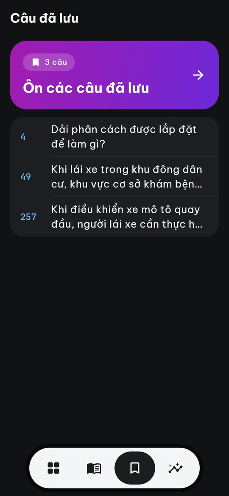

<em>Tab Câu đã lưu</em>
</td>
</tr>
</tbody>
</table>

*Hình 27: Tab Câu đã lưu*

**Mô tả:** Khi học, người dùng bấm biểu tượng lưu (hình dấu trang) ở thanh trên để đánh dấu câu muốn xem lại. Tab Câu đã lưu liệt kê các câu này kèm số câu gốc.

**Cách thao tác:**

1.  Bấm **Ôn các câu đã lưu** để ôn chúng thành một lượt, dùng giao diện làm câu hỏi như mục 3.7.4.

2.  Vuốt một câu sang ngang để bỏ lưu; bấm **Hoàn tác** trên thông báo nếu lỡ tay.

**Kết quả:** Danh sách được lưu trong bảng saved_question; câu được hoàn tác trở lại đúng vị trí cũ.

### 3.7.12. Tìm câu hỏi

<table>
<colgroup>
<col style="width: 100%" />
</colgroup>
<tbody>
<tr class="odd">
<td>
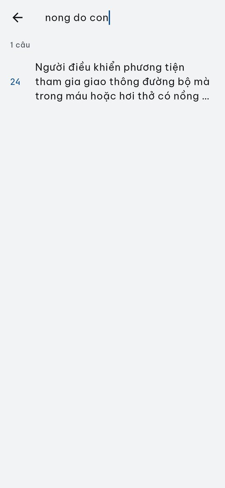

<em>Tìm câu hỏi</em>
</td>
</tr>
</tbody>
</table>

*Hình 28: Tìm câu hỏi*

**Mô tả:** Nút kính lúp ở màn hình chính mở ô tìm câu hỏi trong bộ 600 câu.

**Cách thao tác:**

1.  Bấm biểu tượng kính lúp ở góc trên màn hình chính.

2.  Gõ số câu gốc (ví dụ 24) hoặc từ khóa; gõ không dấu cũng được.

3.  Chạm một kết quả để mở câu đó.

**Kết quả:** Ví dụ gõ “nong do con” ra câu 24 về nồng độ cồn. Ứng dụng hiện số kết quả; mỗi lần gõ chỉ mất khoảng 0,6 ms vì nội dung đã được bỏ dấu sẵn một lần khi mở màn.

### 3.7.13. Đọc câu hỏi

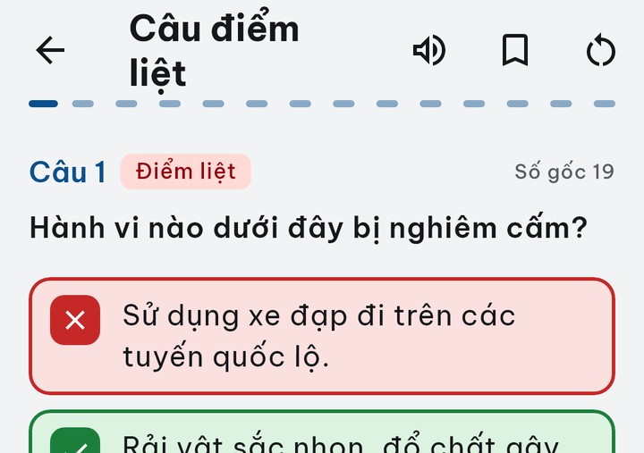

*Hình 29: Nút loa (Đọc câu hỏi) trên thanh trên của màn làm câu hỏi*

**Mô tả:** Chức năng hỗ trợ người học nghe câu hỏi thay vì đọc, dùng bộ đọc giọng nói có sẵn trên điện thoại (không cần mạng).

**Cách thao tác:**

1.  Trên màn làm câu hỏi, bấm biểu tượng **loa** ở thanh trên.

2.  Bấm lại để dừng đọc.

3.  Chuyển sang câu khác và bấm loa để đọc câu mới.

**Kết quả:** Ứng dụng đọc câu hỏi và các đáp án bằng giọng tiếng Việt. Nếu máy chưa có giọng tiếng Việt, ứng dụng hiện hướng dẫn cài đặt (mục 3.6, bước 6).

### 3.7.14. Giới thiệu, nguồn dữ liệu và cài đặt

<table>
<colgroup>
<col style="width: 100%" />
</colgroup>
<tbody>
<tr class="odd">
<td>
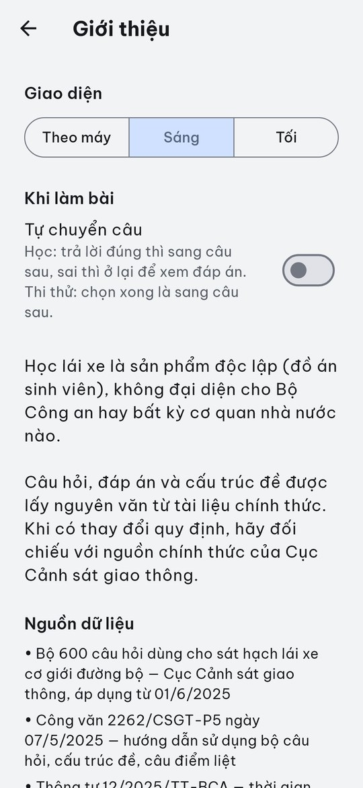

<em>Màn Giới thiệu</em>
</td>
</tr>
</tbody>
</table>

*Hình 30: Màn hình Giới thiệu*

**Mô tả:** Màn Giới thiệu chứa các cài đặt và thông tin nguồn dữ liệu của ứng dụng.

**Cách thao tác:**

1.  Bấm biểu tượng ⓘ ở góc trên màn hình chính.

2.  Chọn giao diện **Theo máy, Sáng** hoặc **Tối**.

3.  Bật/tắt **Tự chuyển câu**: khi học, trả lời đúng thì tự sang câu sau; khi thi, chọn xong là sang câu sau.

**Kết quả:** Lựa chọn có tác dụng ngay và được lưu cho các lần mở sau. Bên dưới là tuyên bố sản phẩm độc lập và danh sách nguồn dữ liệu chính thức: bộ 600 câu hỏi của Cục CSGT, Công văn 2262/CSGT-P5, Thông tư 12/2025/TT-BCA, QCVN 41:2024/BGTVT và Luật 36/2024/QH15.

# CHƯƠNG 4: KIỂM THỬ VÀ KẾT QUẢ THỰC NGHIỆM

## 4.1. Kiểm thử tự động

Nhóm viết unit test cho phần nghiệp vụ và widget test cho cả luồng sử dụng. Test chạy trên dữ liệu thật của ứng dụng và cơ sở dữ liệu SQLite thật trong bộ nhớ; đồng hồ được giả lập để “tua giờ” khi kiểm tra tự nộp bài.

**Bảng 9: Kết quả kiểm thử tự động (30/10/2026)**

| **Hạng mục**                     | **Kết quả**                                                                                                             |
|----------------------------------|-------------------------------------------------------------------------------------------------------------------------|
| Phân tích tĩnh (flutter analyze) | Không có lỗi, không có cảnh báo                                                                                         |
| Kiểm thử tự động (flutter test)  | 178 test đạt, 0 lỗi, trong 31 file test                                                                                 |
| Sinh đề                          | 1.000 đề ngẫu nhiên mỗi hạng đều đúng cấu trúc, không trùng câu, đúng 1 câu điểm liệt; đề cố định luôn ra cùng bộ câu   |
| Chấm điểm                        | Đúng mọi ca: đủ điểm và đúng câu điểm liệt thì Đạt; thiếu 1 điểm, hoặc sai/bỏ trống câu điểm liệt thì Không đạt         |
| Lưu đáp án                       | Nộp 2 lần chỉ chấm 1 lần; sau khi nộp không sửa được đáp án; chấm theo đáp án trong CSDL; mở lại sau hạn giờ thì tự nộp |
| Luồng sử dụng                    | Học chủ đề, ôn câu sai 2 lần, thi từ đầu đến xem lại bài, đổi hạng khi có bài dở đều chạy đúng                          |
| Nâng cấp CSDL                    | Mở CSDL phiên bản 1 rồi nâng lên phiên bản 2 vẫn giữ dữ liệu cũ                                                         |
| Khả năng tiếp cận                | Cỡ chữ 130% không tràn bố cục; vùng chạm ≥ 48dp (test này bắt được 4 chỗ tràn, đã sửa)                                  |
| Dữ liệu                          | Khớp văn bản chính thức: 600 câu, hạng A1/A 250 câu, 20/60 câu điểm liệt; mã băm assets khớp                            |

## 4.2. Kiểm thử thủ công

- **Phiếu kiểm thử 32 mục** (docs/test/phieu-kiem-thu.docx): mở app lần đầu, học chủ đề, ôn câu sai, thi thử, biển báo, thống kê, chế độ tối, và 3 mục chỉ có trên Android (ra ngoài 1 phút thì đồng hồ trừ đúng, tắt app mở lại vẫn còn đáp án, khóa xoay ngang). Ngày 22/10, mục 1–31 được mô phỏng bằng widget test và đạt toàn bộ; đợt này còn phát hiện 2 chỗ phiếu ghi sai và đã sửa phiếu.

- **Chạy trên máy ảo Android** (30/10): đọc tiếng Việt đúng (Google TTS), dừng đọc rồi đọc câu sau đúng, tìm không dấu, lưu câu, nâng cấp cơ sở dữ liệu giữ dữ liệu cũ, nút Back của Android quay về tab Tổng quan, vuốt bỏ lưu và Hoàn tác.

- **Điện thoại thật:** chưa thực hiện đầy đủ (xem mục 5.3).

**\[CẦN BỔ SUNG\]** Kết quả chạy trên điện thoại thật: tên máy, phiên bản Android, thời gian khởi động, thử chế độ máy bay.

## 4.3. Review code và lỗi đã sửa

Ngày 22/10/2026, Kiệt review code, Tài sửa lỗi. Mỗi lỗi sửa xong đều có thêm test; với lỗi mức Cao, nhóm kiểm tra test **thất bại với code cũ và đạt với code mới**.

**Bảng 10: Lỗi phát hiện qua review code**

| **Mức**      | **Lỗi**                                                                                                                                                                                                  | **Cách sửa**                                                                  |
|--------------|----------------------------------------------------------------------------------------------------------------------------------------------------------------------------------------------------------|-------------------------------------------------------------------------------|
| Cao          | Chọn đáp án rồi chuyển câu ngay trong lúc đang lưu thì đáp án có thể ghi nhầm sang câu khác (đúng loại lỗi người dùng phàn nàn ở ứng dụng khác)                                                          | Mỗi trang câu hỏi tự truyền vị trí của nó khi lưu. Thêm test giả lập máy chậm |
| Trung bình   | Màn “Xem lại bài” quay vòng tải mãi khi gặp lỗi                                                                                                                                                          | Hiện thông báo lỗi                                                            |
| Thấp (6 lỗi) | Nộp lỗi thì đồng hồ dừng; bỏ bài lỗi không báo; điểm ở Kết quả/Lịch sử có thể lệch khi dữ liệu đổi; tổng câu ô đề cố định lấy sai cấu trúc; bấm nhanh 2 đáp án bị bỏ lần 2; “Câu hay sai” ghi sai chế độ | Sửa đủ 6 lỗi, thêm test                                                       |

Ngày 30/10, lượt review thứ hai (phần chuyển động, vuốt bỏ lưu) phát hiện và sửa thêm 4 lỗi: thẻ bị lún khi người dùng chỉ định cuộn; ảnh nền “thở” làm cả màn chính vẽ lại mỗi khung hình; vuốt bỏ lưu mà lỗi ghi CSDL thì câu biến mất không báo; Hoàn tác đưa câu xuống cuối danh sách.

## 4.4. Lỗi dữ liệu phát hiện và sửa

**Bảng 11: Lỗi dữ liệu phát hiện qua soát dữ liệu**

| **Ngày** | **Lỗi**                                                                                                       | **Cách sửa**                                                                                     |
|----------|---------------------------------------------------------------------------------------------------------------|--------------------------------------------------------------------------------------------------|
| 06/10    | Câu 180 và 485 bị dính dòng tiêu đề chương                                                                    | Sửa script trích xuất, thêm kiểm tra tự động                                                     |
| 13/10    | 26 câu thiếu hình vì PDF dùng chung một hình cho nhiều câu                                                    | Thêm luật kiểm tra “câu nhắc tới hình mà không có hình”                                          |
| 14/10    | 29 lỗi danh mục biển báo (thiếu hình, sai tên), có cả lỗi in trong chính QCVN (nhãn R.413p đúng ra là R.412p) | Sửa bằng file chỉnh tay có ghi trang đối chiếu, thêm 4 luật kiểm tra; soát lại lần 2, 3 đều đúng |
| 23/10    | Vạch 3.2, 3.3, 3.4 không có hình riêng trong QCVN; tên vạch bị cắt ở chỗ xuống dòng                           | Ghép lại tên nguyên văn; nhóm tự vẽ sơ đồ theo quy cách QCVN, ghi chú “Hình minh họa do nhóm vẽ” |
| 30/10    | Hình biển P.127 lấy nhầm từ một biểu đồ trong QCVN                                                            | Đổi sang hình biển đúng (Hình B.27b trang 90), thêm test chặn lặp lại                            |

## 4.5. Đánh giá kết quả thực nghiệm

Ứng dụng đáp ứng đủ các chức năng đã đặt ra cho ba hạng A1, A, B và chạy ổn định trên máy ảo Android và trình duyệt. Yêu cầu quan trọng nhất là **lưu đáp án tin cậy** được kiểm chứng bằng test riêng, kể cả trường hợp máy chậm, tắt ứng dụng giữa chừng và nộp nhiều lần. Dữ liệu khớp 600/600 đáp án với văn bản chính thức. Việc còn lại là kiểm thử đầy đủ trên điện thoại thật.

# CHƯƠNG 5: SO SÁNH, ƯU ĐIỂM, HẠN CHẾ VÀ HƯỚNG PHÁT TRIỂN

## 5.1. So sánh với ứng dụng hiện có

Nhóm so sánh với ứng dụng “Ôn thi GPLX 600 Câu” của WATERFALL (khoảng 5 triệu lượt tải, 4,9 sao) là ứng dụng phổ biến nhất khi khảo sát. Thông tin về ứng dụng này lấy theo mô tả trên Google Play, chưa kiểm chứng độc lập.

**Bảng 12: So sánh với ứng dụng Ôn thi GPLX 600 Câu (WATERFALL)**

| **Tiêu chí**                     | **Học lái xe (nhóm)**                         | **Ôn thi GPLX 600 Câu (WATERFALL)**                  |
|----------------------------------|-----------------------------------------------|------------------------------------------------------|
| 600 câu theo hạng, câu điểm liệt | Có                                            | Có                                                   |
| Thi thử bấm giờ                  | Có, thêm 20 đề cố định                        | Có                                                   |
| Ôn câu sai, câu hay sai          | Có                                            | Có                                                   |
| Tra cứu biển báo                 | Có, 392 mục theo QCVN 41:2024, tìm không dấu  | Có                                                   |
| Mẹo ghi nhớ                      | Không (cố ý: không có nguồn chính thức)       | Có                                                   |
| Thi mô phỏng tình huống          | Không (ngoài phạm vi)                         | Có ở bản “& Mô phỏng”                                |
| Quảng cáo                        | Không                                         | Có                                                   |
| Lưu đáp án khi thi               | Lưu ngay khi chọn, có test riêng              | Có phản hồi người dùng về việc đáp án bị đổi khi nộp |
| Nguồn dữ liệu                    | Ghi rõ văn bản chính thức ngay trong ứng dụng | Theo mô tả cửa hàng                                  |

So với web mẫu của giảng viên, nhóm bổ sung ba chức năng: Câu đã lưu, Tìm câu hỏi và Đọc câu hỏi.

## 5.2. Ưu điểm

- Không quảng cáo, chạy hoàn toàn offline, không cần tài khoản, không thu thập dữ liệu.

- Dữ liệu lấy nguyên văn từ văn bản chính thức, soát khớp 600/600 đáp án; nguồn được ghi ngay trong ứng dụng.

- Đáp án thi lưu ngay khi chọn, không mất khi tắt ứng dụng, chỉ chấm một lần; được kiểm chứng bằng test.

- Thi thử giống thi thật: không lộ đúng/sai, đồng hồ tính theo giờ thực, nêu rõ lý do trượt.

- Cấu trúc đề là dữ liệu cấu hình theo ngày hiệu lực, nên khi quy định đổi chỉ cần thêm dữ liệu.

- 178 test tự động; giao diện sáng/tối, không vỡ bố cục khi cỡ chữ lớn; cùng mã nguồn chạy trên Android và web.

## 5.3. Hạn chế

### 5.3.1. Hạn chế của sản phẩm

**Bảng 13: Hạn chế của sản phẩm và ảnh hưởng**

| **Hạn chế**                                                                                     | **Ảnh hưởng tới người dùng**                                                                    | **Hướng khắc phục**                                                          |
|-------------------------------------------------------------------------------------------------|-------------------------------------------------------------------------------------------------|------------------------------------------------------------------------------|
| Chưa kiểm thử đầy đủ trên điện thoại thật; nhóm nộp mã nguồn, chưa đóng gói bản APK             | Có thể còn lỗi chỉ xuất hiện trên một số dòng máy; người dùng phổ thông chưa cài trực tiếp được | Thử trên 2–3 máy Android khác hãng; đóng gói APK khi phát hành               |
| Còn 1 lỗi mức thấp: bấm rất nhanh qua nhiều câu lúc đang lưu thì lựa chọn ở câu giữa có thể mất | Câu đó hiện là “chưa trả lời”; điểm vẫn chấm đúng theo dữ liệu đã lưu                           | Xếp hàng mọi lựa chọn đang chờ thay vì chỉ giữ lựa chọn mới nhất             |
| Tiến độ chỉ lưu trên máy, đã tắt sao lưu Android                                                | Gỡ ứng dụng hoặc đổi máy là mất tiến độ                                                         | Thêm xuất/nhập file tiến độ hoặc đăng nhập và đồng bộ                        |
| Chỉ hỗ trợ ba hạng A1, A, B; chưa có thi mô phỏng tình huống                                    | Người học hạng B1, C… chưa dùng được                                                            | Bộ câu đã có, chỉ cần thêm cấu hình đề và bật hạng                           |
| Không có lời giải thích từng câu                                                                | Người học chỉ biết đáp án đúng, không biết vì sao                                               | Bộ đề chính thức không có lời giải; nếu thêm phải trích dẫn điều luật cụ thể |
| Đọc câu hỏi phụ thuộc giọng tiếng Việt có sẵn trên máy; chưa thử trên trình duyệt               | Máy không có giọng tiếng Việt phải tự cài                                                       | Hướng dẫn cài trong ứng dụng (đã có); thử thêm trên Chrome                   |
| Cấu trúc đề mới từ 01/3/2027 chưa áp dụng                                                       | Sau ngày này ứng dụng báo cấu trúc đề đã cũ                                                     | Cập nhật dữ liệu khi có bộ câu hỏi chính thức                                |
| Ảnh màn hình trong báo cáo chụp bằng công cụ test, không phải trên máy thật                     | Có thể khác đôi chút (thanh trạng thái, font hệ thống)                                          | Chụp lại trên máy thật khi kiểm thử                                          |

### 5.3.2. Hạn chế trong cách làm việc của nhóm

- **Khối lượng code dồn vào một người.** Phần lớn mã nguồn do trưởng nhóm làm cùng Claude Code; các thành viên khác chủ yếu đặc tả, soát dữ liệu, kiểm thử và trình bày. Hệ quả là kiến thức về code chưa chia đều, thành viên khác phải đọc lại code của module mình để trả lời vấn đáp. Lịch sử commit trên GitHub phản ánh đúng điều này.

- **Phụ thuộc vào công cụ AI khi viết code.** Tốc độ làm nhanh nhưng cần người hiểu để duyệt; nhóm khắc phục bằng cách bắt buộc mỗi chức năng có test và review code, nhưng các thành viên vẫn cần tự học kỹ hơn về Flutter (vòng đời widget, Riverpod, async/await, SQLite).

- **Bắt đầu kiểm thử trên thiết bị thật quá muộn.** Phần lớn kiểm thử chạy bằng widget test và máy ảo; chưa có lịch thử trên điện thoại của từng thành viên ngay từ đầu.

- **Trễ mốc nội bộ.** Mốc đóng băng tính năng 25/10 và nộp 28/10 bị lùi vì thêm chức năng và làm lại giao diện ở giai đoạn cuối (30/10), làm thời gian kiểm thử và viết báo cáo bị thu hẹp.

- **Họp và báo cáo tiến độ chưa đều.** Việc phân công chủ yếu ghi trong file trạng thái của repo, chưa có buổi họp định kỳ để cả nhóm cùng nắm tình hình.

## 5.4. Hướng phát triển

- Cập nhật cấu trúc đề thi mới từ 01/3/2027 theo Thông tư 108/2026/TT-BCA khi có bộ câu hỏi chính thức (A1/A: 40 câu, 27 phút, đạt 36; B: 50 câu, 33 phút, đạt 45).

- Thêm hạng B1 và các hạng khác; bộ câu đã có, chỉ cần cấu hình đề.

- Trợ lý AI giải thích luật và đáp án, bắt buộc trích dẫn văn bản, điều, khoản; khóa API đặt ở backend, không nằm trong ứng dụng.

- Chụp ảnh nhận diện biển báo: AI chỉ chọn mã biển, nội dung lấy từ danh mục QCVN.

- Đăng nhập và đồng bộ tiến độ giữa các thiết bị; xuất/nhập file tiến độ.

- Đóng gói bản APK và phát hành trên Google Play sau khi kiểm thử trên điện thoại thật.

# CHƯƠNG 6: KẾT LUẬN

Nhóm đã hoàn thành ứng dụng Android “Học lái xe” ôn thi lý thuyết hạng A1, A, B theo bộ 600 câu hỏi chính thức, với **41 chức năng hoàn thành**: học theo chủ đề, ôn câu sai, câu điểm liệt, câu hay sai, thi thử, kết quả và xem lại bài, tra cứu biển báo, thống kê, câu đã lưu, tìm câu hỏi, đọc câu hỏi, giao diện sáng/tối và tự chuyển câu.

Ứng dụng đạt mục tiêu đặt ra: không quảng cáo, chạy offline, dữ liệu đúng văn bản chính thức và lưu đáp án tin cậy. Kết quả được kiểm chứng bằng 178 test tự động, phiếu kiểm thử 32 mục và chạy thử trên máy ảo Android.

Những phần còn hạn chế: chưa kiểm thử đầy đủ trên điện thoại thật và chưa đóng gói bản APK, còn một lỗi nhỏ khi bấm rất nhanh lúc thi, tiến độ chỉ lưu trên một máy; về cách làm việc, khối lượng code chưa chia đều giữa các thành viên.

Qua đồ án, nhóm vận dụng được các kỹ thuật chính của lập trình di động: xây dựng giao diện bằng widget Flutter, quản lý trạng thái với Riverpod, cơ sở dữ liệu cục bộ SQLite với giao dịch (transaction) và nâng cấp phiên bản, điều hướng bằng go_router, xử lý ứng dụng vào nền hoặc bị tắt, đọc văn bản bằng giọng nói và kiểm thử tự động. Hướng phát triển tiếp theo là cập nhật cấu trúc đề 2027, thêm hạng, đồng bộ tiến độ và trợ lý AI có trích dẫn nguồn.

# TÀI LIỆU THAM KHẢO

\[1\] Cục Cảnh sát giao thông – Bộ Công an, Bộ 600 câu hỏi dùng cho sát hạch lái xe cơ giới đường bộ (áp dụng từ 01/6/2025), csgt.bocongan.gov.vn.

\[2\] Cục Cảnh sát giao thông, Công văn số 2262/CSGT-P5 ngày 07/5/2025 hướng dẫn sử dụng bộ câu hỏi, cấu trúc đề, câu điểm liệt.

\[3\] Bộ Công an, Thông tư số 12/2025/TT-BCA quy định về sát hạch, cấp giấy phép lái xe.

\[4\] Bộ Công an, Thông tư số 108/2026/TT-BCA (cấu trúc đề lý thuyết áp dụng từ 01/3/2027).

\[5\] Bộ Giao thông vận tải, QCVN 41:2024/BGTVT Quy chuẩn kỹ thuật quốc gia về báo hiệu đường bộ (ban hành kèm Thông tư 51/2024/TT-BGTVT).

\[6\] Quốc hội, Luật Trật tự, an toàn giao thông đường bộ số 36/2024/QH15.

\[7\] Flutter documentation, https://docs.flutter.dev.

\[8\] Riverpod documentation, https://riverpod.dev.

\[9\] sqflite package, https://pub.dev/packages/sqflite.

\[10\] go_router package, https://pub.dev/packages/go_router.

\[11\] flutter_tts package, https://pub.dev/packages/flutter_tts.
