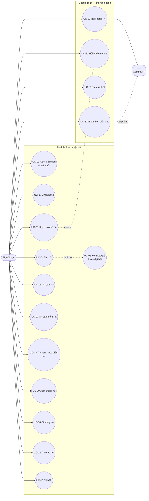

# Đặc tả yêu cầu phần mềm (SRS) — hoclaixe

Phiên bản: 0.4 — cập nhật theo kiến trúc (13/10/2026); phạm vi chỉ còn đồ án LTTTBDD (Module A)
Phạm vi bản này: **Module A chi tiết đầy đủ** (đồ án LTTTBDD, hạn 28/10/2026). Module B, D ở mức khung — viết đủ trong Sprint 2.

## 1. Giới thiệu

### 1.1 Mục đích
Đặc tả yêu cầu cho app hoclaixe — ôn thi lý thuyết sát hạch lái xe hạng A1, A, B. Tài liệu là đầu vào cho UX, kiến trúc,
backlog, test case và báo cáo của cả hai đồ án.

### 1.2 Phạm vi
- **Module A — Luyện đề** (LTTTBDD + chuyên ngành): chọn hạng, học theo chủ đề, thi thử đúng cấu trúc đề, điểm liệt,
  ôn câu sai, danh mục biển báo, thống kê. Chạy hoàn toàn offline, không đăng nhập, không AI.
  Hành vi bám theo các app ôn thi phổ biến trên Google Play (vision §3), giao diện gọn hơn, không quảng cáo.
- **Module B — Chatbot AI**, **Module D — Nhận diện biển báo**: chỉ đồ án chuyên ngành; khung ở §7.3.
- Ngoài phạm vi: thi mô phỏng/video, mẹo ghi nhớ, "Top 50 câu cần chú ý" do app tự chọn (không có nguồn chính thức), hướng dẫn thi thực hành sa hình, quảng cáo, hạng ngoài A1/A/B, đăng nhập/đồng bộ (Could, chuyên ngành).

### 1.3 Thuật ngữ
| Thuật ngữ | Nghĩa |
|---|---|
| Hạng | Hạng giấy phép lái xe: A1, A (mô tô), B (ô tô) |
| Pool | Tập câu hỏi dùng cho một hạng: A1/A 250 câu, B 600 câu (CV 2262) |
| Câu điểm liệt | Câu về xử lý tình huống mất an toàn giao thông nghiêm trọng; trả lời sai → trượt cả bài. Danh sách **phụ thuộc hạng**: A1/A 20 câu, B 60 câu |
| Chương / chủ đề | 6 chương của bộ 600 câu (I Quy định chung… → VI Sa hình) |
| Cấu trúc đề | Số câu, thời gian, điểm đạt, phân bổ câu theo chương của một hạng trong một khoảng hiệu lực |
| Phiên thi | Một lần làm đề thi thử, từ lúc bắt đầu tới khi nộp |
| RAG | Retrieval-Augmented Generation — truy xuất văn bản luật rồi mới cho model sinh câu trả lời |

### 1.4 Tài liệu tham khảo
`docs/srs/vision.md` · `docs/data/sources.md` (CV-2262-2025, TT-12-2025, TT-108-2026, CSGT-600-2025) ·
`data/question-bank/exam-structures.json` · `docs/srs/requirements-draft.md` (Module B, D).

## 2. Mô tả tổng quan

### 2.1 Bối cảnh sản phẩm
App Android độc lập. Bộ 600 câu + hình + cấu trúc đề được đóng gói trong app; tiến độ người học lưu trên máy.
Module B/D (chuyên ngành) bổ sung backend proxy gọi Gemini (chatbot RAG và nhận diện biển báo bằng Gemini vision).

### 2.2 Actor
| Actor | Mô tả |
|---|---|
| Người học | Người đang ôn thi hạng A1, A hoặc B. Dùng app không đăng nhập. Actor duy nhất của Module A |
| Gemini API | Hệ thống ngoài (chỉ Module B, D), gọi qua backend |
| Nhóm phát triển | Cập nhật dữ liệu câu hỏi/luật/biển báo qua bản phát hành mới — không thao tác trong app |

### 2.3 Môi trường vận hành
- Android 7.0 (API 24) trở lên `[ĐỀ XUẤT — chốt trong /create-architecture]`; điện thoại 5–7 inch.
- Hướng màn hình: **khóa dọc** (chốt 04/10/2026); dù khóa, mọi thay đổi cấu hình (xoay nếu cho phép, đổi cỡ chữ, sáng/tối, đa cửa sổ) không làm mất đồng hồ, câu đang xem, đáp án.
- Không cần mạng cho Module A.

### 2.4 Ràng buộc
- C1. Dữ liệu câu hỏi, đáp án, cấu trúc đề chỉ lấy từ nguồn chính thức (`docs/data/sources.md`); app không cho sửa.
- C2. Hạn LTTTBDD 28/10/2026; năng lực ~1 giờ/ngày/người.
- C3. **Danh mục biển báo cần dữ liệu QCVN 41:2024/BGTVT — hiện chưa có** (`data/sign-catalog/` trống). Đã có file QCVN 41:2024 (403 trang, PDF chữ; Phụ lục B trở đi có mã, tên, ý nghĩa và hình từng biển). Trích xuất tự động như bộ câu hỏi, mốc **12/10/2026**; dự phòng nếu trễ: bản 28/10 chỉ gồm các biển xuất hiện trong chương V.
- C4. Không thu thập dữ liệu cá nhân; không quảng cáo.

### 2.5 Giả định
- GA1. Hành vi các màn lấy theo 2 app ôn thi phổ biến — **đã đối chiếu 21 ảnh chụp** trong `design/reference/competitors/` (04/10/2026). Chỉ tham khảo hành vi và bố cục, không sao chép nội dung/hình ảnh.
- GA2. Câu điểm liệt **chưa trả lời** khi nộp/hết giờ được tính là trả lời sai → trượt (TT 12/2025 chấm "kể cả các câu chưa trả lời"; văn bản không nói riêng về câu điểm liệt).
- GA3. Câu điểm liệt cũng được tính 1 điểm trong tổng điểm — suy ra từ thang điểm TT 12/2025 (A1 đạt 21/25, A 23/25, B 27/30 với đề 25/30 câu).
- GA4. Một câu bị bỏ khỏi "Câu sai" khi người học trả lời đúng câu đó **2 lần liên tiếp** (ở bất kỳ chế độ nào); trả lời sai thì đếm lại từ đầu (chốt 13/10/2026).
- GA5. Lịch sử trả lời gắn với câu hỏi (không theo hạng); các màn lọc theo pool của hạng đang chọn.
- GA6. Trong đề thi, câu được sắp theo thứ tự nhóm của BR-02 (ch.I → điểm liệt → … → ch.VI), trong mỗi nhóm thứ tự ngẫu nhiên. **Không xáo thứ tự đáp án** (nhiều câu có đáp án dạng "Cả ba ý trên", "Biển 1 và biển 3" phụ thuộc thứ tự).
- GA7. App là công cụ luyện tập offline: chỉnh đồng hồ máy có thể làm sai thời gian còn lại khi mở lại phiên dở — chấp nhận, không chặn. Khi app đang chạy, đồng hồ đếm theo bộ đếm đơn điệu của hệ thống.

## 3. Sơ đồ use case tổng quát

UC-11 (Chọn cấu trúc đề 2027) gộp vào UC-13 và tạm Won't cho tới khi có hướng dẫn của Cục CSGT (vision §5).

## 4. Yêu cầu chức năng

Ưu tiên theo vision §5. Đồ án: LT = LTTTBDD, CN = chuyên ngành.

### 4.1 Module A
| Mã | Mô tả | Ưu tiên | Đồ án | Use case |
|---|---|---|---|---|
| FR-A01 | Lần mở app đầu tiên hiển thị tuyên bố miễn trừ (sản phẩm độc lập, không đại diện cơ quan nhà nước; nguồn dữ liệu: tên văn bản, số hiệu, ngày hiệu lực; link nguồn chính thức). Người học bấm "Đồng ý" mới vào app; lựa chọn được lưu, không hỏi lại | Must | LT, CN | UC-01 |
| FR-A02 | Màn Giới thiệu (từ menu) hiển thị lại tuyên bố miễn trừ, danh sách nguồn, phiên bản dữ liệu (`sourceVersion`), phiên bản app | Must | LT, CN | UC-01 |
| FR-A03 | Sau miễn trừ lần đầu, người học chọn hạng A1, A hoặc B (nhóm Xe máy: A1, A; nhóm Ô tô: B); mỗi hạng hiện mô tả loại xe được lái (trích Luật TTATGTĐB 2024 `[CẦN NGUỒN: điều, khoản — data-curator]`), số câu, thời gian, điểm đạt của đề hiện hành | Must | LT, CN | UC-02 |
| FR-A04 | Người học đổi hạng bất kỳ lúc nào từ màn chính; hạng đang chọn được lưu và hiển thị ở màn chính | Must | LT, CN | UC-02 |
| FR-A10 | Danh sách chủ đề = "Tất cả câu hỏi" (cả pool) + nhóm "Câu điểm liệt" + các chương có câu trong pool của hạng đang chọn; mỗi chủ đề hiện thanh tiến độ và **Đúng / Sai / Chưa làm / Tổng** (Đúng/Sai theo kết quả **mới nhất** của từng câu, gộp từ học, ôn và thi thử) | Must | LT, CN | UC-03 |
| FR-A11 | Trong chế độ học, chọn một đáp án → hiển thị ngay đúng/sai, tô đáp án đúng, khóa câu (không đổi được); chỉ lần chọn này được ghi nhận và **lưu ngay** như FR-A24. Câu điểm liệt có nhãn "Điểm liệt". Bấm "Làm lại" để tạo lượt mới | Must | LT, CN | UC-03 |
| FR-A12 | Câu có hình hiển thị hình; chạm hình mở chế độ xem lớn: chụm 2 ngón phóng to tới ≥ 3 lần, kéo được, chạm đúp trở về | Must | LT, CN | UC-03, UC-04 |
| FR-A13 | Chuyển câu trước/sau và nhảy tới câu bất kỳ trong chủ đề; app nhớ vị trí câu cuối cùng của từng chủ đề | Must | LT, CN | UC-03 |
| FR-A20 | Bắt đầu thi thử → tạo đề ngẫu nhiên theo cấu trúc đề hiện hành của hạng (BR-02, BR-03), không trùng câu | Must | LT, CN | UC-04 |
| FR-A20b | Bộ đề cố định: mỗi hạng có **20 đề** (số đề là cấu hình) sinh sẵn theo BR-02, BR-03 với hạt giống ngẫu nhiên (seed) cố định — mở lại app vẫn đúng các đề đó. Danh sách đề hiện trạng thái Đạt / Chưa đạt / Chưa làm và điểm lần làm gần nhất; tổng "x / 20 đề đã hoàn thành". Đề ngẫu nhiên (FR-A20) vẫn có ở cùng màn | Should | LT, CN | UC-04 |
| FR-A21 | Màn thi hiển thị đồng hồ đếm ngược dạng mm:ss theo thời gian của cấu trúc đề (sai số ≤ 1 giây so với giờ thực, kể cả khi app ở nền), số thứ tự câu, tổng số câu; khi còn 60 giây đồng hồ đổi màu cảnh báo | Must | LT, CN | UC-04 |
| FR-A22 | Người học chuyển tới/lui, nhảy câu qua lưới số câu; lưới phân biệt câu đã trả lời / chưa trả lời / đang xem. **Không hiện nhãn "Điểm liệt" trên câu nào trong lúc thi** (giống phần mềm sát hạch); nhãn chỉ hiện ở Kết quả / Xem lại bài. *(Could)* Đánh dấu câu phân vân — dấu hiện trên lưới | Must | LT, CN | UC-04 |
| FR-A23 | Người học chọn và đổi đáp án tự do trước khi nộp; **không hiển thị đúng/sai trong lúc thi** (chế độ mặc định "Chấm sau khi nộp — giống thi sát hạch") | Must | LT, CN | UC-04 |
| FR-A23b | Màn thông tin đề cho chọn chế độ chấm: "Chấm sau khi nộp" (mặc định) hoặc "Chấm ngay khi chọn đáp án" (hiện đúng/sai và khóa câu như FR-A11; đồng hồ, nộp bài, chấm điểm không đổi) | Could | LT, CN | UC-04 |
| FR-A24 | **Mỗi lần chọn đáp án được lưu ngay vào bộ nhớ máy**; đáp án được giữ nguyên khi chuyển câu, quay lại câu cũ, xoay màn hình, app vào nền, app bị tắt, và khi nộp bài. Đáp án trong màn kết quả, xem lại bài và lịch sử **khớp 100%** với đáp án lúc nộp | Must | LT, CN | UC-04, UC-05 |
| FR-A25 | Mở lại app khi còn phiên thi dở → hỏi "Tiếp tục bài thi?"; tiếp tục với thời gian còn lại tính theo giờ thực (BR-06); nếu đã hết giờ → tự nộp và hiện kết quả | Must | LT, CN | UC-04 |
| FR-A26 | Nộp bài: hộp thoại xác nhận nêu số câu chưa trả lời; hết giờ → tự nộp không cần xác nhận (kể cả khi hộp thoại xác nhận đang mở). Mỗi phiên chỉ nộp một lần (bấm lặp không tạo thêm kết quả) | Must | LT, CN | UC-04 |
| FR-A27 | Chấm bài theo BR-04, BR-05: điểm, số câu đúng/sai/chưa trả lời, Đạt/Không đạt; nêu rõ lý do trượt (thiếu điểm / sai câu điểm liệt) | Must | LT, CN | UC-05 |
| FR-A28 | Xem lại bài của phiên vừa nộp: từng câu hiện đáp án đã chọn, đáp án đúng, nhãn điểm liệt; lọc "chỉ câu sai" (mở rộng nhỏ so với vision) | Must | LT, CN | UC-05 |
| FR-A29 | Lưu lịch sử các lần thi thử (ngày giờ, hạng, điểm, đạt/không đạt) và mở lại phần xem lại bài của từng lần | Should | LT, CN | UC-05, UC-09 |
| FR-A30 | Danh mục biển báo theo nhóm QCVN 41:2024 (cấm, nguy hiểm và cảnh báo, hiệu lệnh, chỉ dẫn, phụ, vạch kẻ đường `[CHỐT trong /data-plan]`): danh sách hình + mã + tên; chạm để xem chi tiết (hình lớn, mã, tên, ý nghĩa) | Must | LT, CN | UC-08 |
| FR-A31 | Tìm biển báo theo mã hoặc tên (mở rộng nhỏ so với vision) | Should | LT, CN | UC-08 |
| FR-A40 | Mọi câu trả lời sai (học, ôn, thi thử) và câu **bỏ trống khi nộp bài thi** được thêm vào danh sách "Câu sai" | Must | LT, CN | UC-06 |
| FR-A41 | Ôn câu sai: làm lại các câu sai thuộc pool của hạng đang chọn theo cách của chế độ học (FR-A11); trả lời đúng 2 lần liên tiếp → bỏ khỏi danh sách (GA4) | Must | LT, CN | UC-06 |
| FR-A42 | Ôn câu điểm liệt: làm các câu điểm liệt **của hạng đang chọn** (A1/A 20 câu, B 60 câu) theo cách của chế độ học | Must | LT, CN | UC-07 |
| FR-A50 | Thống kê: tiến độ từng chủ đề (% câu đã làm đúng), số lần thi thử, tỉ lệ đạt, điểm gần nhất | Should | LT, CN | UC-09 |
| FR-A51 | Câu hay sai của bản thân: tối đa 50 câu có **tổng số lần sai** (mọi chế độ, không reset khi trả lời đúng) nhiều nhất trong pool của hạng, sắp giảm dần; chỉ hiện câu sai ≥ 1 lần; làm lại theo chế độ học | Should | LT, CN | UC-10 |
| FR-A60 | Tìm câu hỏi theo từ khóa trong nội dung câu và đáp án, không phân biệt hoa/thường và có/không dấu; kết quả ≤ 500 ms | Could | LT, CN | UC-12 |
| FR-A61 | Cài đặt: giao diện sáng/tối/theo hệ thống | Could | LT, CN | UC-13 |
| FR-A62 | Cài đặt: xóa toàn bộ tiến độ (có xác nhận) | Could | LT, CN | UC-13 |
| FR-A70 | Cập nhật app (đổi `sourceVersion`, nâng phiên bản DB) không làm mất tiến độ: tiến độ gắn với `id` câu ổn định (Q0001…Q0600); câu bị bỏ khỏi bộ mới thì ẩn khỏi thống kê | Must | LT, CN | — |

### 4.2 Module B, D — khung (viết chi tiết trong Sprint 2)
| Mã | Mô tả (theo `requirements-draft.md`) | Ưu tiên | Đồ án | Use case |
|---|---|---|---|---|
| FR-B01 | Hộp thoại cảnh báo AI lần đầu, bấm "Tôi đã hiểu" mới dùng | Must | CN | UC-20 |
| FR-B02 | Dòng cảnh báo cố định + nút "Kiểm chứng" dưới mỗi câu trả lời | Must | CN | UC-20 |
| FR-B03 | Mỗi câu trả lời liệt kê văn bản–điều–khoản lấy từ dữ liệu truy xuất | Must | CN | UC-20 |
| FR-B04 | Không đủ căn cứ → trả lời "không tìm thấy căn cứ" | Must | CN | UC-20 |
| FR-B05 | Nút "Báo sai" + ghi chú lý do | Must | CN | UC-22 |
| FR-B06 | Nút "Hỏi AI về câu này" trong màn học / xem lại bài | Must | CN | UC-21 |
| FR-B10 | Tra cứu luật: văn bản → điều → khoản | Should | CN | UC-23 |
| FR-D01…D06 | Như FR-SIGN-01…06 trong `requirements-draft.md` | Must/Should | CN | UC-30, UC-31 |

## 5. Luật nghiệp vụ

| Mã | Nội dung | Nguồn (sources.md) |
|---|---|---|
| BR-01 | Cấu trúc đề hiện hành (01/6/2025 – 28/02/2027): **A1** 25 câu, 19 phút, đạt ≥ 21; **A** 25 câu, 19 phút, đạt ≥ 23; **B** 30 câu, 20 phút, đạt ≥ 27. Mỗi câu 1 điểm, 2–4 ý trả lời | TT-12-2025 PL II.A.I, PL IV.A; CV-2262-2025 II |
| BR-02 | Phân bổ đề: **A1, A** = 8 câu ch.I + 1 câu điểm liệt + 1 ch.II + 1 ch.III hoặc IV + 8 ch.V + 6 ch.VI. **B** = 8 ch.I + 1 điểm liệt + 1 ch.II + 1 ch.III + 1 ch.IV + 9 ch.V + 9 ch.VI | CV-2262-2025 II.1, II.5 |
| BR-03 | Pool: A1, A dùng 250 câu (Phụ lục 1); B dùng 600 câu. Câu điểm liệt của đề chọn trong danh sách điểm liệt **của hạng đó** (A1/A: 20 câu, mục 6 "Nhóm 20 câu/60 câu…" của Phụ lục 1; B: 60 câu, Phụ lục 3); các câu còn lại chọn trong pool trừ câu điểm liệt của hạng | CV-2262-2025 I.2, PL1–3 |
| BR-04 | Điểm = số câu trả lời đúng (gồm câu điểm liệt, GA3). Câu chưa trả lời = sai | TT-12-2025 (chấm cả câu chưa trả lời) |
| BR-05 | **Đạt** khi điểm ≥ điểm đạt **và** câu điểm liệt trả lời đúng. Sai (hoặc chưa trả lời, GA2) câu điểm liệt → **Không đạt** dù đủ điểm | TT-12-2025; CV-2262-2025 I.1 ghi chú |
| BR-06 | Hết thời gian làm bài → tự động nộp và chấm. Thời gian tính theo giờ thực từ lúc bắt đầu (app vào nền hay bị tắt vẫn tính) | TT-12-2025 ("hết thời gian … được máy tính tự động chấm") |
| BR-07 | Đáp án đúng của mỗi câu là đáp án gạch chân trong bộ 600 câu; app không cho thay đổi | CV-2262-2025 I.1 ghi chú |
| BR-09 | Phiên thi lưu ảnh chụp (snapshot): danh sách id câu theo thứ tự, id cấu trúc đề, thời điểm bắt đầu, đáp án từng câu. Cập nhật dữ liệu hay sang ngày hiệu lực mới không làm đổi phiên đang làm. Mỗi lúc tối đa **1 phiên dở**. Đồng hồ bắt đầu khi người học bấm "Bắt đầu" | Thiết kế (bảo đảm FR-A24, FR-A25) |
| BR-08 | App chọn cấu trúc đề có khoảng hiệu lực chứa ngày hiện tại và `status` khác `incomplete`. Không có → dùng cấu trúc hợp lệ gần nhất và hiển thị cảnh báo "Đề theo quy định trước 01/3/2027" | TT-108-2026 Đ41; `exam-structures.json` |

## 6. Yêu cầu phi chức năng

| Mã | Loại | Mô tả có số đo |
|---|---|---|
| NFR-01 | Offline | 100% chức năng Module A dùng được ở chế độ máy bay |
| NFR-02 | Tin cậy | Sau khi chạm chọn đáp án, buộc dừng app (force-stop) trong vòng 100 ms rồi mở lại → đáp án vừa chọn vẫn còn. Lặp mỗi kịch bản của FR-A24 (chuyển câu, quay lại, đổi cấu hình, vào nền, tắt app, nộp bài) ≥ 20 lần: 0 lỗi |
| NFR-03 | Hiệu năng | Khởi động nguội tới màn chính ≤ 3 giây; chuyển câu ≤ 300 ms; tạo đề thi ≤ 1 giây — trên máy Android tầm trung `[ĐIỀN máy test]` |
| NFR-04 | Đúng dữ liệu | Validator dữ liệu PASS trước mỗi bản build; 100% câu có nguồn |
| NFR-05 | Đúng nghiệp vụ | Unit test sinh đề: 1.000 đề ngẫu nhiên mỗi hạng đều đúng BR-02, BR-03 (đúng số câu mỗi nhóm, không trùng, đúng 1 câu điểm liệt của hạng) |
| NFR-05b | Đúng nghiệp vụ | Unit test chấm điểm, bảng ca bắt buộc cho mỗi hạng A1, A, B: đủ điểm nhưng sai câu điểm liệt → Không đạt; đủ điểm nhưng bỏ trống câu điểm liệt → Không đạt; thiếu 1 điểm nhưng đúng câu điểm liệt → Không đạt; đúng bằng ngưỡng (21/23/27) và đúng câu điểm liệt → Đạt; đúng toàn bộ → Đạt; bỏ trống toàn bộ → Không đạt. 100% pass |
| NFR-06 | Kích thước | APK release ≤ 50 MB |
| NFR-07 | Khả năng tiếp cận | Không vỡ bố cục khi cỡ chữ hệ thống 130%; vùng chạm ≥ 48dp; bật TalkBack duyệt màn chính, màn thi, màn kết quả: mọi nút và đáp án đọc được tên |
| NFR-08 | Riêng tư | Không thu thập dữ liệu cá nhân; không quyền mạng cho bản LTTTBDD `[CHỐT trong /create-architecture]` |
| NFR-09 | Ngôn ngữ | Giao diện tiếng Việt; 0 chuỗi hiển thị viết cứng trong widget — mọi chuỗi nằm trong file chuỗi/l10n (kiểm bằng lint/grep) |

## 7. Đặc tả use case chi tiết

### UC-01: Xem giới thiệu và tuyên bố miễn trừ
| Mục | Nội dung |
|---|---|
| Actor | Người học |
| Mô tả | Người học đọc tuyên bố miễn trừ và nguồn dữ liệu trước khi dùng app; xem lại bất cứ lúc nào |
| Tiền điều kiện | — |
| Hậu điều kiện | Lần đầu: trạng thái "đã đồng ý" được lưu |
| Luồng chính | 1. Người học mở app lần đầu. 2. App hiển thị tuyên bố miễn trừ + nguồn. 3. Người học bấm "Đồng ý". 4. App lưu trạng thái, chuyển sang UC-02 |
| Luồng thay thế | 1a. Đã đồng ý trước đó → vào màn chính. 1b. Mở "Giới thiệu" từ menu → hiển thị nội dung, không có nút Đồng ý |
| Ngoại lệ | E1. Người học thoát app ở bước 2 → lần sau vẫn hiện lại |
| Yêu cầu liên quan | FR-A01, FR-A02, NFR-01 |

### UC-02: Chọn hạng
| Mục | Nội dung |
|---|---|
| Actor | Người học |
| Mô tả | Chọn hạng A1, A, B để app dùng đúng pool và cấu trúc đề |
| Tiền điều kiện | Đã đồng ý miễn trừ |
| Hậu điều kiện | Hạng được lưu; mọi màn lọc theo pool của hạng |
| Luồng chính | 1. App hiện 3 hạng với số câu, thời gian, điểm đạt (BR-01). 2. Người học chọn một hạng. 3. App lưu và mở màn chính |
| Luồng thay thế | 2a. Đổi hạng từ màn chính → chọn hạng mới → màn chính cập nhật. 2b. Đang có phiên thi dở của hạng cũ → hỏi "Bỏ bài thi đang làm?"; Bỏ → xóa phiên dở, đổi hạng; Hủy → giữ hạng cũ và phiên dở |
| Ngoại lệ | — |
| Yêu cầu liên quan | FR-A03, FR-A04, BR-01, BR-03, BR-08 |

### UC-03: Học theo chủ đề
| Mục | Nội dung |
|---|---|
| Actor | Người học |
| Mô tả | Làm lần lượt các câu của một chủ đề, biết đúng/sai ngay |
| Tiền điều kiện | Đã chọn hạng |
| Hậu điều kiện | Kết quả từng câu được lưu (lịch sử, câu sai, tiến độ chủ đề) |
| Luồng chính | 1. Người học mở "Học theo chủ đề". 2. App hiện chủ đề với số câu và tiến độ (FR-A10). 3. Người học chọn chủ đề. 4. App mở câu đang dở (hoặc câu đầu). 5. Người học chọn đáp án. 6. App hiện đúng/sai, tô đáp án đúng, lưu kết quả. 7. Người học chuyển câu (FR-A13). Lặp 5–7 |
| Luồng thay thế | 5a. Câu có hình → chạm phóng to (FR-A12). 6a. Trả lời sai → thêm vào Câu sai (FR-A40). 7a. Hết chủ đề → hiện tóm tắt đúng/sai, nút "Ôn câu sai của chủ đề" |
| Ngoại lệ | E1. Hình không tải được → hiện khung "Không hiển thị được hình" và mã câu để báo lỗi. E2. App bị tắt giữa chừng → kết quả các câu đã chọn vẫn còn (lưu ngay, FR-A11); mở lại chủ đề → về câu đang dở |
| Yêu cầu liên quan | FR-A10–A13, FR-A40, NFR-01, NFR-03 |

### UC-04: Thi thử
| Mục | Nội dung |
|---|---|
| Actor | Người học |
| Mô tả | Làm một đề ngẫu nhiên đúng cấu trúc và thời gian như thi thật |
| Tiền điều kiện | Đã chọn hạng; có cấu trúc đề hợp lệ (BR-08) |
| Hậu điều kiện | Kết quả phiên vừa nộp được lưu (Must, phục vụ FR-A28); câu sai và câu bỏ trống vào danh sách Câu sai; lịch sử nhiều lần thi là Should (FR-A29) |
| Luồng chính | 1. Người học bấm "Thi thử" → chọn "Đề ngẫu nhiên" hoặc một đề trong bộ đề cố định (FR-A20b). 2. App hiện thông tin đề (số câu, thời gian, điểm đạt, số câu điểm liệt — sai là trượt), chế độ chấm (FR-A23b) và nút Bắt đầu. 3. App tạo đề (FR-A20), bắt đầu đếm giờ. 4. Người học chọn đáp án; app lưu ngay (FR-A24). 5. Người học chuyển câu / dùng lưới (FR-A22), đổi đáp án nếu muốn. 6. Người học bấm Nộp bài, xác nhận (FR-A26). 7. App chấm (BR-04, BR-05) → UC-05 |
| Luồng thay thế | 1a. Đang có phiên dở → hỏi "Tiếp tục bài đang làm" hay "Bỏ và làm đề mới" (BR-09). 6a. Hết giờ → tự nộp (BR-06) → UC-05, kể cả khi hộp thoại nộp đang mở. 6b. Bấm Nộp nhiều lần → chỉ một lần nộp có hiệu lực (FR-A26). 4a. App vào nền / bị tắt → mở lại → hỏi Tiếp tục (FR-A25). 4b. Người học bấm Nộp bài hoặc nút quay lại → bảng chọn: **Nộp bài và chấm điểm** · **Lưu tạm và thoát** (giữ bài làm, đồng hồ vẫn chạy theo BR-06) · **Không lưu và thoát** (xác nhận, xóa phiên) · **Tiếp tục làm bài** |
| Ngoại lệ | E1. Lỗi ghi bộ nhớ khi lưu đáp án → báo lỗi, giữ đáp án trên màn hình, thử lưu lại; **nộp tay** bị chặn tới khi lưu được; **hết giờ** vẫn chấm theo đáp án đang hiển thị kèm cảnh báo "Một số đáp án chưa được lưu". E2. Mở lại sau khi thời gian đã hết (kể cả nhiều ngày sau) → tự nộp với các đáp án đã lưu, câu chưa làm tính là chưa trả lời. E3. App bị tắt trong lúc chấm/lưu kết quả → lần mở sau hoàn tất việc chấm đúng một lần (không mất, không nhân đôi kết quả) |
| Yêu cầu liên quan | FR-A20–A27 (gồm A20b, A23b), FR-A40, BR-01–BR-09, NFR-02, NFR-05, NFR-05b |

### UC-05: Xem kết quả và xem lại bài
| Mục | Nội dung |
|---|---|
| Actor | Người học |
| Mô tả | Xem kết quả và từng câu đã làm của một phiên thi |
| Tiền điều kiện | Phiên thi đã nộp |
| Hậu điều kiện | — |
| Luồng chính | 1. App hiện kết quả: Đạt/Không đạt, điểm/thang điểm, đúng/sai/chưa trả lời, lý do trượt (FR-A27). 2. Người học bấm "Xem lại bài". 3. App hiện từng câu: đáp án đã chọn, đáp án đúng, nhãn điểm liệt (FR-A28) |
| Luồng thay thế | 3a. Bật lọc "Chỉ câu sai". 1a. Mở từ lịch sử thi (FR-A29) |
| Ngoại lệ | — |
| Yêu cầu liên quan | FR-A27–A29, BR-04, BR-05 |

### UC-06: Ôn câu sai
| Mục | Nội dung |
|---|---|
| Actor | Người học |
| Mô tả | Làm lại các câu từng trả lời sai cho tới khi đúng |
| Tiền điều kiện | Đã chọn hạng |
| Hậu điều kiện | Câu trả lời đúng bị bỏ khỏi danh sách |
| Luồng chính | 1. Người học mở "Ôn câu sai". 2. App hiện số câu sai trong pool của hạng. 3. Người học làm từng câu như UC-03 bước 5–7. 4. Trả lời đúng → bỏ khỏi danh sách (GA4) |
| Luồng thay thế | 2a. Danh sách rỗng → "Bạn chưa có câu sai" + gợi ý Thi thử |
| Ngoại lệ | — |
| Yêu cầu liên quan | FR-A40, FR-A41 |

### UC-07: Ôn câu điểm liệt
| Mục | Nội dung |
|---|---|
| Actor | Người học |
| Mô tả | Học riêng các câu điểm liệt của hạng đang chọn |
| Tiền điều kiện | Đã chọn hạng |
| Hậu điều kiện | Kết quả lưu như UC-03 |
| Luồng chính | 1. Người học mở "Câu điểm liệt". 2. App hiện danh sách câu điểm liệt của hạng (A1/A 20, B 60) và tiến độ. 3. Làm từng câu như UC-03 bước 5–7 |
| Luồng thay thế | — |
| Ngoại lệ | — |
| Yêu cầu liên quan | FR-A42, BR-03 |

### UC-08: Tra danh mục biển báo
| Mục | Nội dung |
|---|---|
| Actor | Người học |
| Mô tả | Xem biển báo theo nhóm và ý nghĩa |
| Tiền điều kiện | Dữ liệu danh mục biển báo đã có trong app (ràng buộc C3) |
| Hậu điều kiện | — |
| Luồng chính | 1. Người học mở "Biển báo". 2. App hiện các nhóm. 3. Người học chọn nhóm → danh sách hình + mã + tên. 4. Chạm một biển → chi tiết |
| Luồng thay thế | 2a. Tìm theo mã/tên (FR-A31) |
| Ngoại lệ | — |
| Yêu cầu liên quan | FR-A30, FR-A31 |

### UC-09 Xem thống kê · UC-10 Câu hay sai · UC-12 Tìm câu hỏi · UC-13 Cài đặt (Should/Could)
| UC | Luồng chính rút gọn | Yêu cầu |
|---|---|---|
| UC-09 | Mở Thống kê → tiến độ theo chủ đề, số lần thi, tỉ lệ đạt, điểm gần nhất; chạm một lần thi → UC-05 | FR-A29, FR-A50 |
| UC-10 | Mở Câu hay sai → tối đa 50 câu sai nhiều nhất của hạng → làm lại như UC-03 | FR-A51 |
| UC-12 | Gõ từ khóa → danh sách câu khớp trong pool → chạm để xem câu (chế độ học) | FR-A60 |
| UC-13 | Đổi giao diện sáng/tối; Xóa tiến độ → xác nhận → xóa lịch sử, câu sai, phiên thi | FR-A61, FR-A62 |

### 7.3 Module B, D (khung)
UC-20 Hỏi chatbot AI · UC-21 Hỏi AI về một câu hỏi · UC-22 Báo sai câu trả lời AI · UC-23 Tra cứu luật ·
UC-30 Nhận diện biển báo bằng ảnh · UC-31 Sửa kết quả nhận diện sai — đặc tả chi tiết trong Sprint 2 (`/write-srs update`).

## 8. Chỗ mơ hồ cần chốt
| # | Vấn đề | Đề xuất |
|---|---|---|
| Q1 | Hành vi app đối thủ (GA1) chưa đối chiếu ảnh | Kiểm lại khi có ảnh; sửa SRS bằng `/write-srs update` |
| Q2 | Câu điểm liệt chưa trả lời (GA2) | Tính là sai → trượt (an toàn cho người học) |
| Q3 | Nhóm biển báo và nội dung chi tiết (FR-A30) | Chốt trong `/data-plan` theo QCVN 41:2024 |
| Q4 | Android tối thiểu, máy test hiệu năng (NFR-03, NFR-08) | Chốt trong `/create-architecture`, trước khi viết test hiệu năng |
| Q5 | Khóa màn hình dọc hay cho xoay | **Đã chốt: khóa dọc**; test FR-A24 vẫn gồm đổi cấu hình |
| Q6 | Dữ liệu biển báo cho FR-A30 (Must, hạn 28/10) | **Đã chốt**: trích xuất từ QCVN 41:2024 trước 12/10; dự phòng: chỉ biển trong chương V |
| Q8 | Đánh số câu: đối thủ đánh lại 1…250 trong pool A1/A; bộ chính thức đánh 1…600 | **Chốt 14/10**: số to = thứ tự trong chủ đề/đề ("Câu 5"), góc phải chữ nhỏ "Số gốc 36" để tra PDF (ST-05) |
| Q7 | Tải Must: ~27 FR Must cho ~50 giờ | Gom thành 9 nhóm Must khi `/create-stories`; PM xác nhận trong `/sprint-plan`. Cắt trước: FR-A29, A50, A51 (Should) |

## 9. Lịch sử thay đổi
| Phiên bản | Ngày | Nội dung | Người |
|---|---|---|---|
| 0.1 | 04/10/2026 | Bản đầu: Module A chi tiết, Module B/D khung | business-analyst (Claude) |
| 0.2 | 04/10/2026 | Sửa theo review qa-engineer: 2 mâu thuẫn (UC-04 E1/BR-06, hướng màn hình), NFR-02 đo được, thêm NFR-05b, BR-09, FR-A70, GA6–GA7, làm rõ FR-A10/A11/A12/A21/A40/A51/A60, luồng phiên dở/nộp lặp | business-analyst (Claude) |
| 0.4 | 13/10/2026 | Theo `/create-architecture` + repo tham khảo: GA4 đổi thành đúng 2 lần liên tiếp; FR-A22 không hiện nhãn điểm liệt khi đang thi. Phạm vi chỉ còn LTTTBDD (Module A) | business-analyst (Claude) |
| 0.3 | 04/10/2026 | Đối chiếu ảnh 2 app đối thủ: thêm FR-A20b bộ đề cố định 20 đề (Should), FR-A23b chế độ chấm ngay (Could), đánh dấu câu (Could), bảng chọn khi thoát bài thi, FR-A10 Đúng/Sai/Chưa làm/Tổng + chủ đề "Tất cả câu hỏi", mô tả hạng; thêm Won't; Q8 | business-analyst (Claude) |
