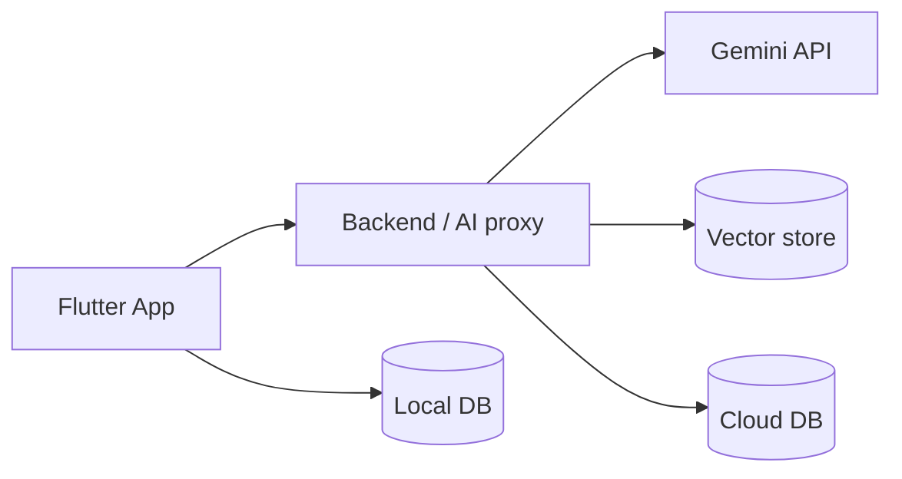

# Kiến trúc hệ thống

## 1. Tổng quan (sơ đồ khối)

## 2. Công nghệ đã chọn (link ADR)
## 3. Kiến trúc ứng dụng Flutter (phân lớp, cấu trúc thư mục)
## 4. Thiết kế dữ liệu (ERD)
## 5. Luồng chính (sequence diagram): thi thử, hỏi chatbot
## 6. API (tóm tắt, chi tiết ở api.md)
## 7. Offline & đồng bộ
## 8. Bảo mật
## 9. Khả năng mở rộng sang Web
## 10. Rủi ro kỹ thuật
